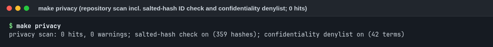

# Ethics

> **Research prototype. Not a medical device. Not for diagnosis, screening or clinical decisions.**

This file covers what we did to protect the people whose recordings we used, how the model could be misused,
and where it is unfair by construction.

## 1. Data protection

**What is in this repository.**

- Code, the SHA-256 hashes and a summary of the pre-registered protocols, aggregate model metrics, figures built
  from those aggregates, synthetic EEG, and the model weights.
- No raw EEG of our subjects and no EEG-derived data descriptions (spectra, signal statistics, file metadata), no
  per-subject rows, no subject codes or folder names, no ages of individuals, no recording dates or times, no EDF
  headers, and nothing that names the hackathon, the data provider or the recording device. Every table cell and
  figure group has at least 5 people.
- The EEG traces shown in figures come from a public dataset (CC BY 4.0, credited) or from our synthetic generator.
- An automated scan (`make privacy`, [`tools/privacy_scan.py`](tools/privacy_scan.py)) checks every file, notebook
  output and screenshot log for identifier patterns, a salted-hash list of the real codes and a confidentiality
  denylist (both kept outside the repository), non-Latin text, dates, EDF files, pickles and large files. It runs
  in CI (without the private lists) and reported 0 hits with both lists before release.

  

**Terms of the data.** The recordings were made available to hackathon participants under a data agreement, for
the task only. They are confidential: we do not share them in any form, and the hackathon, the data provider and
the recording details are withheld under the same agreement ([DATA_ACCESS.md](DATA_ACCESS.md)).

**What the public weights contain.** The deployed model is 90 fold members, one per left-out training subject.
For the public release they were converted from a Python pickle to plain arrays:

- removed: the list of training subject codes and the inner-selection audit trail;
- kept: per member and bag, the imputation values, winsor bounds, scaling centre and scale, LDA coefficients and
  intercept, plus the clip range, threshold and fallback;
- the member order was shuffled, so a member can no longer be matched to a subject by position;
- predictions from the public weights match the delivered model on every real subject folder: maximum score
  difference 1.7e-16 (floating-point summation order after the shuffle), no decision changed
  ([`results/weights_equivalence.json`](results/weights_equivalence.json)).

**The residual risk, in plain words.** Each member was trained on everyone except one person. Two members
therefore differ only in which single person was left out. Someone who compares members with each other may be able
to learn a little about that missing person: for example, whether they were in the PTSD or the control group (the class
balance of the fold shifts by one), and roughly where their four EEG feature values sat relative to the group
(medians, percentile bounds and scales move by one data point). They cannot learn a name, a code, an age, a date
or any raw signal, and because the order is shuffled they cannot say which member belongs to which person. The
features are four numbers about alpha and beta rhythm, not a clinical record. We judged this acceptable for a
research release that is meant to be exactly reproducible. If it is not acceptable to the data owners, the
alternative is to withdraw `weights/` and keep only the code and aggregates.

## 2. Misuse

This model must not be used to make or support any decision about a person. In particular:

- **Screening** of soldiers, veterans, refugees or any population. The model does not separate PTSD from valid
  controls (AUC 0.435 [0.256, 0.604]); a positive score means almost nothing.
- **Insurance, compensation or disability claims.** A low score is not evidence against PTSD, and a high score is
  not evidence for it.
- **Employment, deployment or security vetting.** Scores depend on the recording device and session, not on the
  person's mental health.
- **Legal proceedings** of any kind.

The MIT license cannot forbid these uses; this file, the [disclaimer](DISCLAIMER.md) and the
[model card](MODEL_CARD.md) state the intent. If you see the model being used this way, please open an issue.

## 3. Age and sex confounding

- **Age.** The ages of PTSD patients are not recorded per person. Controls skew young; the evaluation
  groups include people aged 65 and over. Alpha rhythm slows and weakens with age, and so does processing speed.
  The shipped model flags no one in the 65+ group, but only because their alpha is low; a model using the
  task-duration feature would flag 0.826 of them. Within all controls, the model's inputs predict age with R² 0.154
  [0.013, 0.268]. Any real application would need age norms.
- **Sex.** Sex composition differs between the groups and is not recorded per person. Alpha frequency differs
  by sex, so somatoform false positives cannot be separated from a sex effect, and the model cannot be assumed
  to behave the same for women and men.

## 4. Somatoform false positives

People with somatoform (persistent physical symptom) disorders are a clinically important comparison: trauma is
common among them, and published EEG shows higher alpha in this group. Our model flags 13 of 74 somatoform
recordings (0.176). Applied to a clinic, it would label a substantial share of somatoform patients as
"PTSD-like", which could delay the right care. This is the main specificity failure and is reported in every
results table.

## 5. Honesty commitments we kept

- The decision rule was hashed before any candidate was scored; nothing was re-tuned after results.
- The AUC against valid controls is reported next to every headline AUC.
- AUCs below 0.5 are reported as they are, not inverted.
- Negative results, including the external check, are published.
- AI assistance is disclosed ([docs/ai_assistance.md](docs/ai_assistance.md)).
