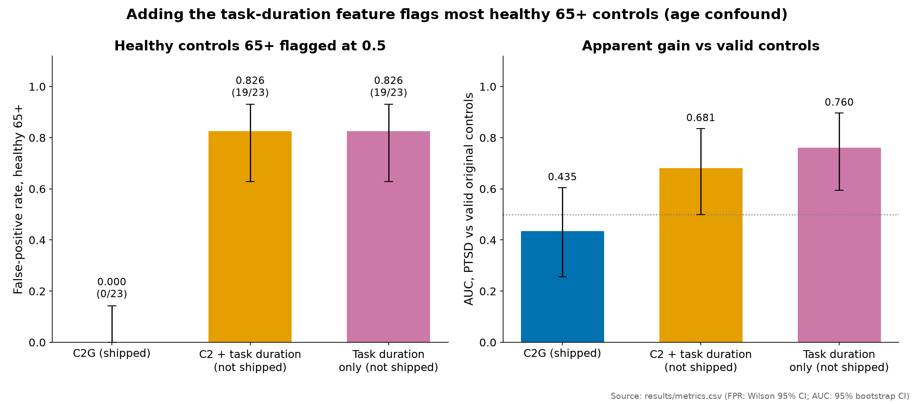

# Model card: ptsd-eeg C2G (release v4.1.0)

> **Research prototype. Not a medical device. Not for diagnosis, screening or clinical decisions.**

Format follows Model Cards for Model Reporting (Mitchell et al. 2019) [M1]. Numbers come from
[`results/metrics.csv`](results/metrics.csv) and are checked by script.

## Model details

- **Name / version.** C2G, release v4.1.0 (recipe C2 plus a minimum-data gate).
- **Type.** Ensemble of 90 nested-LOSO fold members; each member is 100 stratum-balanced bootstrap bags of a
  shrinkage linear discriminant on four transformed EEG features. The score is the mean member output.
- **Input.** One eyes-closed resting EEG file (EDF) from a 6-channel consumer EEG headband (O1, T3, Fp1, Fp2, T4, O2),
  about 1 minute, about 125 Hz.
- **Output.** A score in [0, 1] described by the task as "closeness to the PTSD cohort phenotype". Decision
  threshold 0.5. Unscorable, too short (< 30 s) or truncated recordings get the fixed fallback 24/90 = 0.267.
- **Features.** `rest_IAF`, `rest_rel_alpha_O`, `rest_rel_alpha_IAF`, `rest_rel_beta_O` (O1/O2), see
  [docs/science.md](docs/science.md).
- **Weights.** [`weights/`](weights/): plain arrays, no subject identifiers, member order shuffled. Predictions match
  the delivered model to floating-point precision, with no decision changed
  ([`results/weights_equivalence.json`](results/weights_equivalence.json)).
- **Pre-registration.** PROTOCOL_v4 (SHA-256 `88ef6934…b047`) and Amendment 1 (SHA-256 `38ad28a9…83d8`). The
  protocol texts describe the confidential data and are not published; their hashes and a summary of the decision
  rule are in [`protocols/README.md`](protocols/README.md).
- **Developer.** Bogdan (zititank), with hackathon teammates AdetyTy and Qwertyqwerty579. Project for an international medical AI hackathon (name withheld under the data
  agreement), 2026. Development was heavily AI-assisted ([docs/ai_assistance.md](docs/ai_assistance.md)).
- **License.** MIT.

## Intended use

- Research and teaching: a reference implementation of subject-level nested LOSO, pre-registered model selection,
  batch-artefact diagnosis and reproducibility checks on small EEG datasets.
- Re-analysis by researchers who have legitimate access to the same data.

## Out-of-scope uses

- Any diagnosis, screening, triage, monitoring or treatment decision for any person.
- Screening of soldiers, veterans, employees, applicants, insurance clients or asylum seekers.
- Use on other devices, montages, eyes-open recordings, children, or populations not represented here.
- Reporting the score as a probability of having PTSD. It is not calibrated.

## Training data

- 90 scorable training subjects: 24 PTSD (clinical cohort) and 66 controls. Of the controls, 46 belong to control
  batch B, which is non-physiological, and 20 are valid.
- Evaluation-only groups, never trained on: somatoform, 65+ and control set C (young controls). The specificity
  metric is the false-positive rate over the 97 somatoform and 65+ folders.
- The data are confidential under the hackathon's data agreement and are not included or available
  ([DATA_ACCESS.md](DATA_ACCESS.md)).

## Metrics

Out-of-fold for training subjects; ensemble scores for evaluation-only groups; 95% CIs from 2000 batch-stratified
subject bootstraps.

| Metric | Value |
|---|---|
| AUC, PTSD vs all training controls | 0.816 [0.750, 0.875] |
| **AUC, PTSD vs valid controls** | **0.435 [0.256, 0.604]** |
| AUC, PTSD vs control batch B | 0.982 [0.937, 1.000] |
| Sensitivity at 0.5 (24 scorable PTSD) | 5/24 = 0.208 |
| Specificity, training controls | 0.894 |
| Balanced accuracy | 0.551 [0.466, 0.640] |
| FPR, somatoform + 65+ (97 folders) | 13/97 = 0.134 [0.072, 0.206] |
| Proxy points, 30·(2·AUC − 1) + 20·(1 − FPR) | 36.30 [32.02, 39.92] |
| Decision flip rate under bootstrap refitting | 0.089 |

**The model does not separate PTSD from valid controls.** The headline AUC comes from control batch B.

## Subgroup results

Positive rate at threshold 0.5 per group among scorable recordings (from
[`results/C2G_batch_table.csv`](results/C2G_batch_table.csv)). The headline FPR above also counts unscorable
recordings, which get the fallback score and are therefore negative.

| Group | Scorable | Positive | Positive rate (scorable) |
|---|---|---|---|
| PTSD | 24 | 5 | 0.208 |
| Controls, batch B | 46 | 0 | 0.000 |
| Controls, valid (other sessions) | 20 | 7 | 0.350 |
| Somatoform | 57 | 13 | 0.228 |
| Control set C (young) | 37 | 4 | 0.108 |
| 65+ controls | 21 | 0 | 0.000 |

Read this table with the batch problem in mind: valid controls are flagged more often (7 of 20) than PTSD patients
(5 of 24). The 65+ group scores low because its alpha is low, not because the model is specific.

Age is the subgroup that decided against the task-duration variants: they looked better against valid controls
but flagged most healthy controls aged 65+.

*Adding the task-duration feature raises AUC vs valid controls (0.435 → 0.681 / 0.760) but flags 19/23 healthy
controls aged 65+ (FPR 0.826 vs 0.000): an age confound, so these variants were not shipped
([docs/limitations.md](docs/limitations.md)).*

## Factors and confounders

- **Acquisition batch** dominates everything. EDF header fields alone separate PTSD from controls with AUC 0.970.
- **Age.** PTSD ages are not recorded per person; controls skew young; the 65+ group has low alpha.
  Within all controls, the model's inputs predict age with R² 0.154 [0.013, 0.268].
- **Sex.** Sex composition differs between groups and is not recorded per person.
- **Clinical overlays** (medication, sleep loss, head injury, alcohol) all move the same EEG features and are
  undocumented. See [ETHICS.md](ETHICS.md) and [docs/limitations.md](docs/limitations.md).

## Evaluation beyond the training data

External direction check on public data (Mendeley Rwanda PTSD, CC BY 4.0, n = 15, eyes open): occipital alpha vs
PCL-5 severity, device-stratified ρ −0.04 [−0.63, 0.59], p = 0.45; the C2 score vs PCL-5 ρ +0.005, p = 0.99.
Null and underpowered ([docs/external_check.md](docs/external_check.md)).

## Caveats and recommendations

- Do not use the score on people. Treat it as a demonstration of a validation pipeline and of a failure mode.
- Any follow-up needs matched acquisition across groups, recorded age, medication and sleep, eyes-open rest,
  and an external site before any claim ([docs/limitations.md](docs/limitations.md)).
- Reporting follows TRIPOD+AI where applicable ([docs/tripod_ai_checklist.md](docs/tripod_ai_checklist.md)).
