<p align="center">
  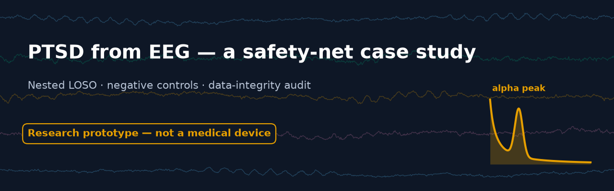
</p>

<h1 align="center">ptsd-eeg-prototype</h1>

<p align="center">
  <b>My PTSD model scored AUC 0.816. It was detecting broken recordings. This repository is how I caught it.</b>
</p>

<p align="center">
  <a href="https://github.com/zititank/ptsd-eeg-prototype/actions/workflows/ci.yml"></a>
  <a href="LICENSE"></a>
  
  
  
  
  <a href="DISCLAIMER.md"></a>
</p>

> **Research prototype. Not a medical device. Not for diagnosis, screening or clinical decisions.**

<table>
  <tr>
    <td align="center" width="25%">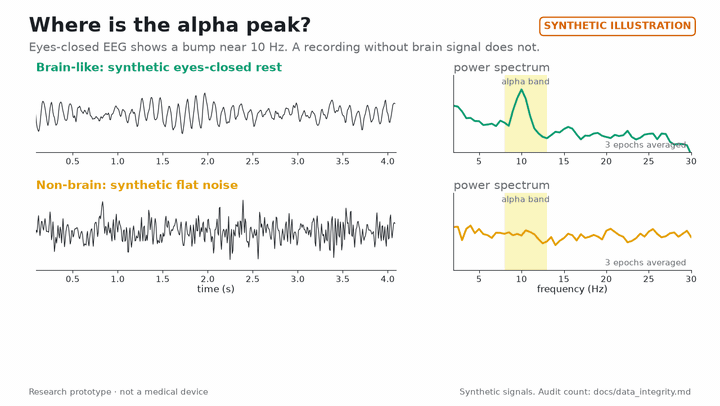<br><sub>Is it brain? 0 of 46 recordings in one control batch had an alpha peak.</sub></td>
    <td align="center" width="25%">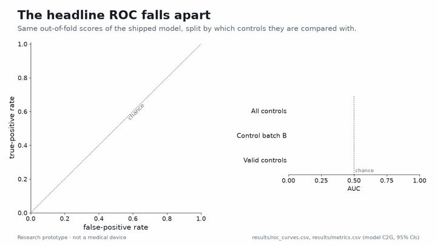<br><sub>AUC 0.816 against all controls, 0.435 against valid ones.</sub></td>
    <td align="center" width="25%">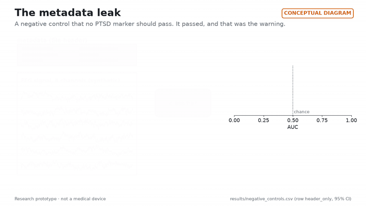<br><sub>File metadata alone: AUC 0.97.</sub></td>
    <td align="center" width="25%">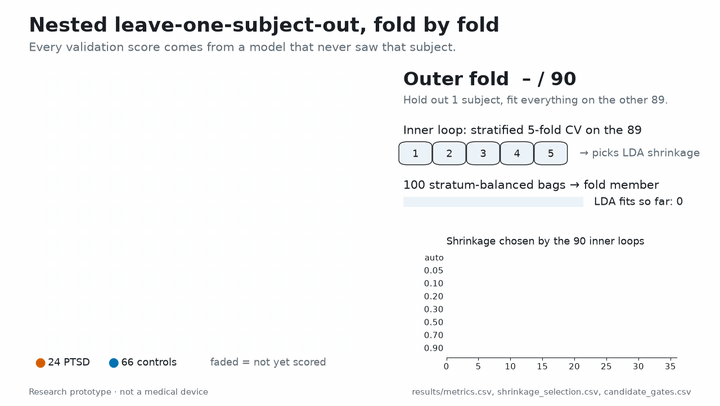<br><sub>Nested LOSO: 90 folds, one person held out each time.</sub></td>
  </tr>
</table>

A reproducible pipeline that scores a one-minute, eyes-closed recording from a 6-channel consumer EEG headband for
similarity to a PTSD cohort. It was built for a task of an international medical AI hackathon (name withheld under
the data agreement) and validated with nested leave-one-subject-out cross-validation and a pre-registered decision
rule. The data (about 90 people, about 24 with PTSD, plus a somatoform comparison group) are confidential and are
not in this repository.

## Highlights

- **An honest negative result.** There is no EEG biomarker of PTSD here. Against physiologically valid controls
  the shipped model scores AUC 0.435 [0.256, 0.604], which is chance.
- **The artefact, found and explained.** None of the 46 rest recordings in control batch B has an alpha peak. That
  batch alone gives AUC 0.982, and a metadata-only classifier reaches 0.97.
- **Validation that doesn't leak.** Nested leave-one-subject-out over 90 people, every learned step fitted inside the
  fold, and a label-permutation AUC of 0.349 inside the null range [0.142, 0.580].
- **Rules before results.** The model-selection rule was written and SHA-256-hashed before any candidate was scored.
- **Reproducible.** Retraining reproduces within 5e-16, the clean-environment difference is 0.0, and a script checks
  every number in the docs against `results/`.
- **Safe to publish.** No raw EEG, no per-subject rows, no identifiers. Pickle-free weights, and a privacy scan that
  must report 0 hits in CI.

## The story in one paragraph

We reached the oral defense stage of an international medical AI hackathon (name withheld under the data agreement)
with this model. While preparing to explain what it had learned, I noticed that its main weight pointed the wrong
way biologically. That led me to ask "is this even brain?" before "is this PTSD?", and one control batch failed.
The model had learned brokenness, not biomarkers. The full story and the lessons are in
**[docs/story.md](docs/story.md)**; the plain-language version is in [docs/eli5.md](docs/eli5.md).

*Built by [Bogdan (zititank)](https://github.com/zititank) with [AdetyTy](https://github.com/AdetyTy) and
[Qwertyqwerty579](https://github.com/Qwertyqwerty579). See [Team](#team).*

## TL;DR

- **We did not find an EEG biomarker of PTSD.** The shipped model reaches AUC 0.816 [0.750, 0.875] against all
  training controls, but 0.435 [0.256, 0.604] against the 20 physiologically valid controls. That is chance.
- **The headline AUC is a data artefact.** 46 of the 66 training controls come from one batch ("control
  batch B") whose recordings contain no brain signal: none of the 46 rest files has an alpha peak. Against that
  batch alone the AUC is 0.982 [0.937, 1.000]. File metadata alone separated the groups with AUC 0.97.
- **The model's main weight points the wrong way biologically.** It scores more occipital alpha as more
  PTSD-like, while the literature predicts less or unchanged alpha. It is detecting "real EEG vs non-EEG".
- **What is solid:** subject-level nested LOSO, a decision rule hashed before any result, leakage tests, bit-level
  reproducibility (retrain within 5e-16, clean-environment difference 0.0), a data-integrity audit, and an
  external check on public data (null, underpowered).
- **Why publish it:** as a worked example of how a respectable-looking AUC can come from acquisition artefacts,
  and how to catch that before anyone believes it.

## Why I built this

I'm a biomedical engineering student and a software engineer, not an ML researcher. I joined the hackathon to find
out whether a cheap six-electrode headset could say anything about PTSD, and I ended up presenting the project at
the oral defense. Preparing that defense is what made me audit the model: its biggest weight said "more alpha means
more PTSD", the opposite of the literature, and following that thread led to a control batch with no brain signal
in it.

What surprised me is that the useful thing I built was not the classifier but the safety nets around it:
subject-level splits, rules hashed before results, negative controls, scripted number checks. AI agents wrote most
of the code, so my job became deciding what to check. The full story, with the lessons and the numbers behind them, is in
[docs/story.md](docs/story.md).

## Method at a glance

| Step | What happens | Code |
|---|---|---|
| Input | the single eyes-closed rest file of a subject (O1, T3, Fp1, Fp2, T4, O2 at about 125 Hz) | [`io.py`](src/ptsd_eeg/io.py) |
| Minimum-data gate | shorter than 30 s, truncated or unreadable → fixed fallback score 24/90 = 0.267 | [`qc.py`](src/ptsd_eeg/qc.py) |
| Features (Set A) | Welch spectrum of O1/O2 → individual alpha frequency and three relative band powers | [`features.py`](src/ptsd_eeg/features.py) |
| Transforms | centred log-ratio / logit, then in-fold median imputation, winsorising (1st/99th percentile), robust scaling | [`transforms.py`](src/ptsd_eeg/transforms.py) |
| Classifier | shrinkage LDA, 100 stratum-balanced bootstrap bags, output clipped to [0.02, 0.98] | [`model.py`](src/ptsd_eeg/model.py) |
| Ensemble | the deployed score is the mean of the 90 nested-LOSO fold members | [`weights/`](weights/) |

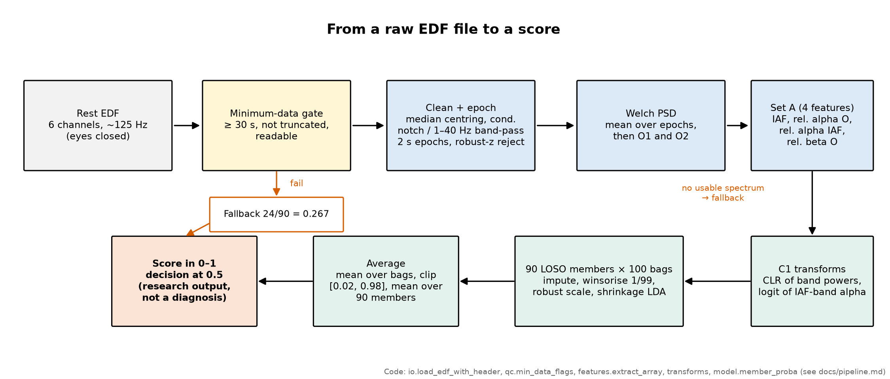

*From a rest EDF to a score: minimum-data gate (fallback 24/90), cleaning and epoching, Welch PSD, the four Set A
features, C1 transforms, the 90 × 100 bagged shrinkage-LDA ensemble, decision at 0.5.*

Full description: [docs/science.md](docs/science.md) and [docs/pipeline.md](docs/pipeline.md).

## Markers and weights

Four features of the occipital (O1/O2) resting spectrum, fed to the model after transformation. Weights are the
mean standardized LDA coefficients over all 9000 fits (90 members × 100 bags) of the shipped model; one unit is
one training-fold interquartile range.

| Model input | Built from | Definition | Mean weight | Share of fits positive |
|---|---|---|---|---|
| `clr_alpha_O` | `rest_rel_alpha_O` | power 8–13 Hz / power 1–40 Hz, centred log-ratio | +1.57 | 98.7% |
| `logit_alpha_IAF` | `rest_rel_alpha_IAF` | power in IAF ± 2 Hz / power 1–40 Hz, logit | +0.55 | 89.0% |
| `rest_IAF` | `rest_IAF` | frequency of the alpha peak in 7–14 Hz | −0.31 | 24.3% |
| `clr_beta_O` | `rest_rel_beta_O` | power 13–30 Hz / power 1–40 Hz, centred log-ratio | +0.05 | 48.9% |

In plain words: the model is almost entirely "more alpha → higher score". IAF and beta carry no stable
information. The literature expects the opposite direction for alpha, which is how we found the data problem.
See [docs/science.md §6](docs/science.md#6-weights-what-the-model-actually-uses).

## Validation: nested leave-one-subject-out

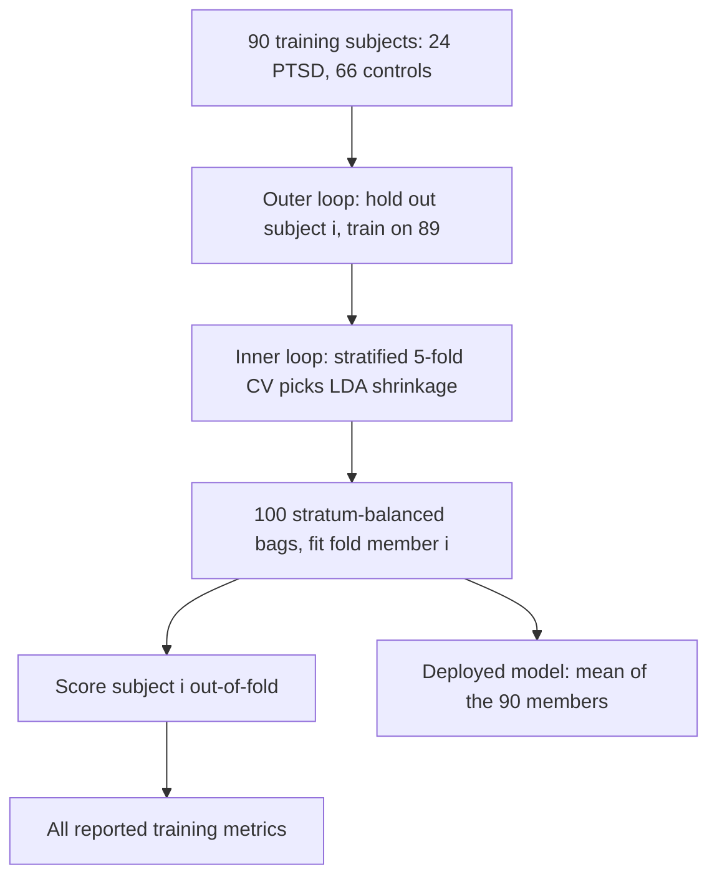

- Every file of one person stays on one side of every split, as the task required.
- All learned steps (imputer, winsor bounds, scaler, shrinkage, bags) are fitted inside the training fold.
- The shipped ensemble is exactly the 90 fold members that produced the validation scores.
- Leakage tests: perturbing a held-out subject leaves its fold model bit-identical, and a label-permutation run
  gives AUC 0.349, inside the recorded null range [0.142, 0.580].
- The model was chosen by a rule written and hashed before any candidate was scored. The protocol texts describe
  the confidential data, so only their SHA-256 hashes and a summary of the decision rule are published:
  [`protocols/README.md`](protocols/README.md) (outcome in [docs/model_selection.md](docs/model_selection.md)).

## Results

Out-of-fold scores on 90 training subjects; somatoform and 65+ groups scored by the ensemble; 95% bootstrap CIs
(2000 resamples, stratified by batch).

| Metric | v3 (previous model) | C2G (shipped, v4.1) |
|---|---|---|
| AUC, PTSD vs all training controls | 0.749 [0.629, 0.843] | 0.816 [0.750, 0.875] |
| AUC, PTSD vs valid controls | 0.410 [0.235, 0.577] | **0.435 [0.256, 0.604]** |
| AUC, PTSD vs control batch B | 0.896 [0.768, 1.000] | 0.982 [0.937, 1.000] |
| Sensitivity at 0.5 | 9/24 | 5/24 |
| False-positive rate, somatoform + 65+ | 21/97 | 13/97 [0.072, 0.206] |
| Proxy points (pre-registered score) | 30.59 | 36.30 (Δ +5.70 [+1.78, +10.91]) |
| Decision flip rate under refitting | 0.106 | 0.089 |

C2G wins the pre-registered comparison by flagging fewer somatoform patients, not by finding PTSD better.

## Figure gallery

Every figure is rebuilt by `make figures` from the model-output CSVs in `results/`, the public weights, public data or
synthetic signals; full captions are in [figures/CAPTIONS.md](figures/CAPTIONS.md). No EEG or EEG-derived value of
the confidential cohort is shown anywhere: the brain vs non-brain illustration is synthetic.

### Animations

Each GIF links to its MP4; all are rebuilt by `make animations` from `results/` and synthetic signals
([media/README.md](media/README.md)).

| | |
|---|---|
| [](media/roc_falls_apart.mp4) | [](media/brain_vs_nonbrain.mp4) |
| Same out-of-fold scores, split by control batch: against valid controls the model is at chance. [MP4](media/roc_falls_apart.mp4) | Synthetic illustration. In the real data, 46 of 46 rest files in control batch B had no alpha peak. [MP4](media/brain_vs_nonbrain.mp4) |
| [](media/metadata_leak.mp4) | [](media/loso_folds.mp4) |
| Conceptual diagram. Metadata alone gave AUC 0.97; our negative control caught it. [MP4](media/metadata_leak.mp4) | Every validation score comes from a model that never saw that subject. [MP4](media/loso_folds.mp4) |
| [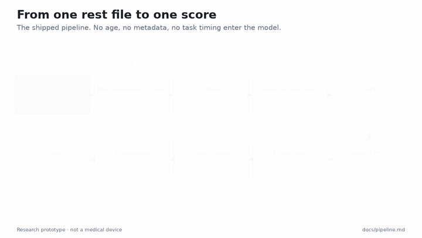](media/pipeline_flow.mp4) | |
| The shipped pipeline, from one rest file to one score. [MP4](media/pipeline_flow.mp4) | |

### Figures

| | |
|---|---|
| 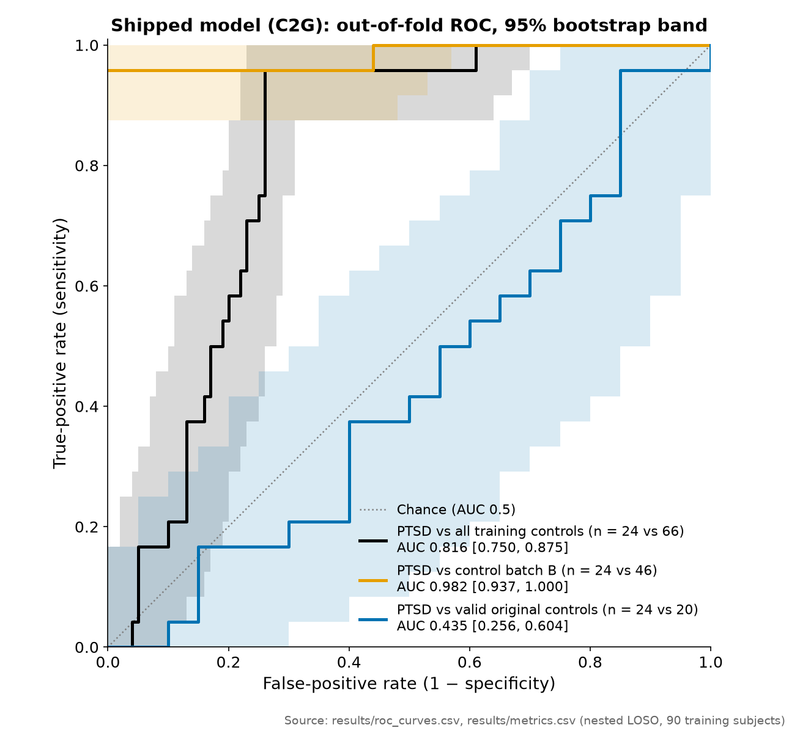 | 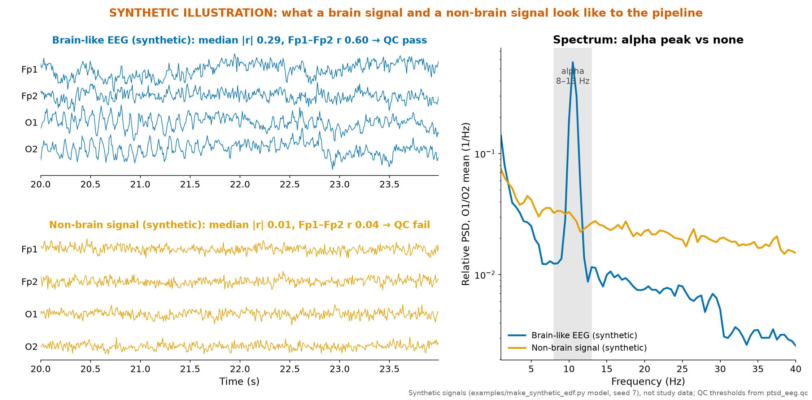 |
| ROC of the shipped model: AUC 0.816 vs all controls, 0.982 vs control batch B, 0.435 vs valid controls (chance). | Synthetic illustration of the audit's label-free checks: a brain-like signal has coupled channels and an alpha peak; a non-brain signal has neither. In the real data, 46/46 control batch B rest files had no alpha peak. |
| 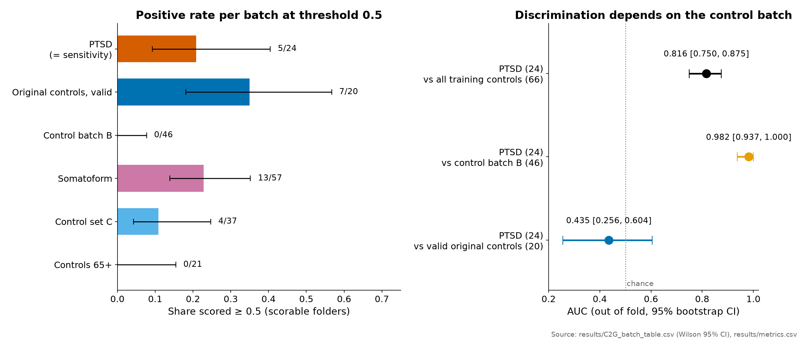 | 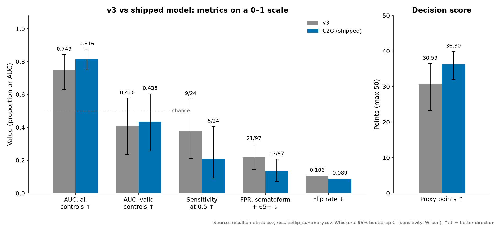 |
| Positive rate per batch and AUC against each control batch. | v3 vs the shipped model on the pre-registered metrics, with 95% CIs. |
| 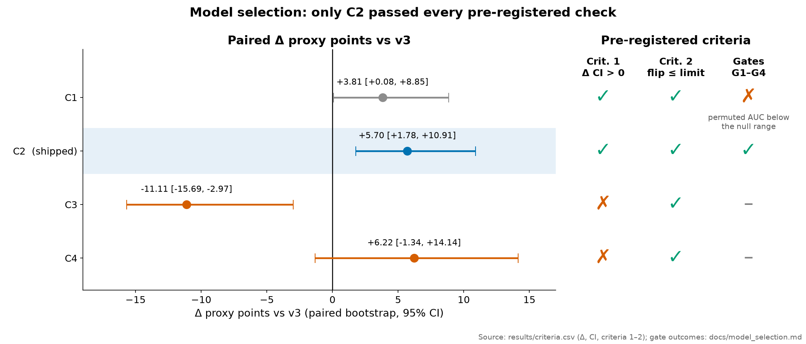 | 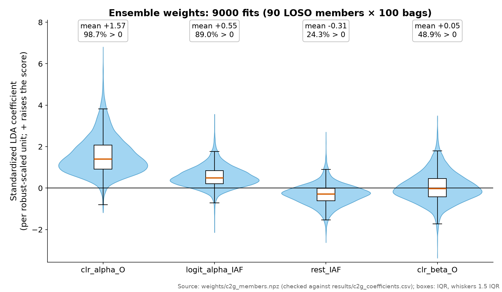 |
| Pre-registered selection: only C2 passed every criterion and gate, so it shipped (as C2G). | The 9000 standardized coefficients per model input; `clr_alpha_O` is positive in 98.7% of fits. |
| 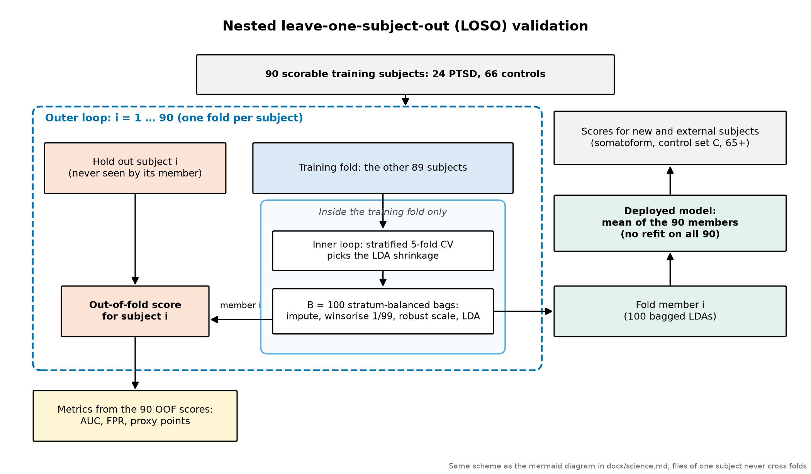 | 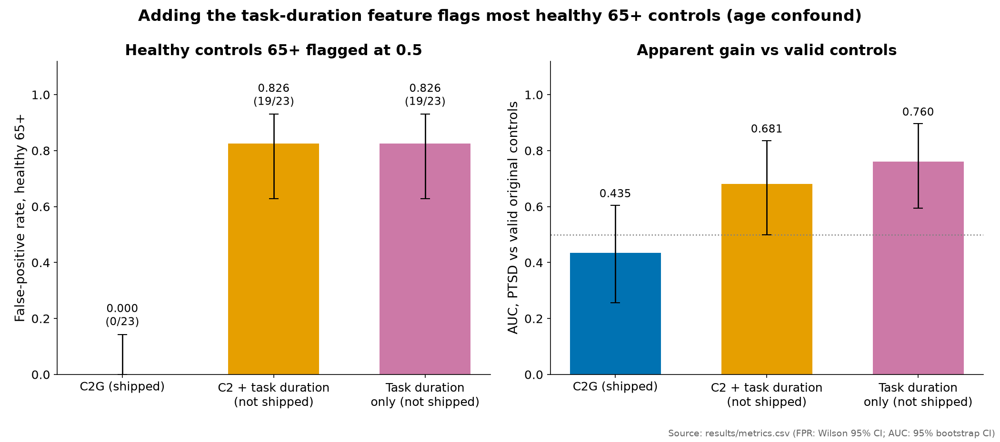 |
| Nested leave-one-subject-out: 90 outer folds, inner CV for shrinkage, the deployed model is the mean of the members. | Adding the task-duration feature looks better vs valid controls but flags 19/23 healthy controls aged 65+: not shipped. |
| 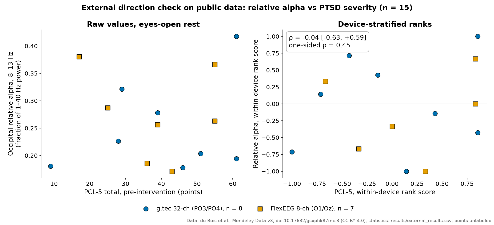 | 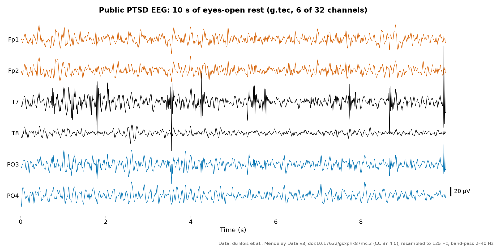 |
| External check on public data (Mendeley, CC BY 4.0, n = 15): no relation between alpha and PTSD severity. | Ten seconds of a public Mendeley recording (CC BY 4.0), for what raw EEG looks like. |
| 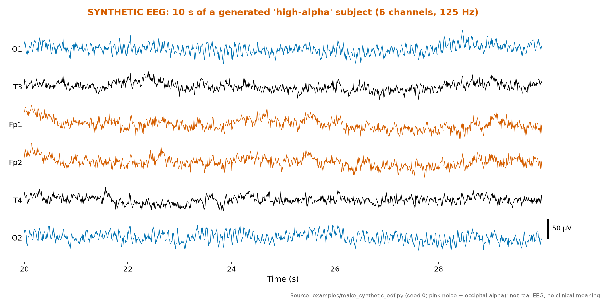 | |
| Ten seconds of a synthetic "high-alpha" subject used by the demo; not real EEG. | |

## Screenshots of real local runs

Captured on the build machine by `make screenshots` (`tools/make_screenshots.py`); logs are privacy-scanned before
rendering.

| | |
|---|---|
| 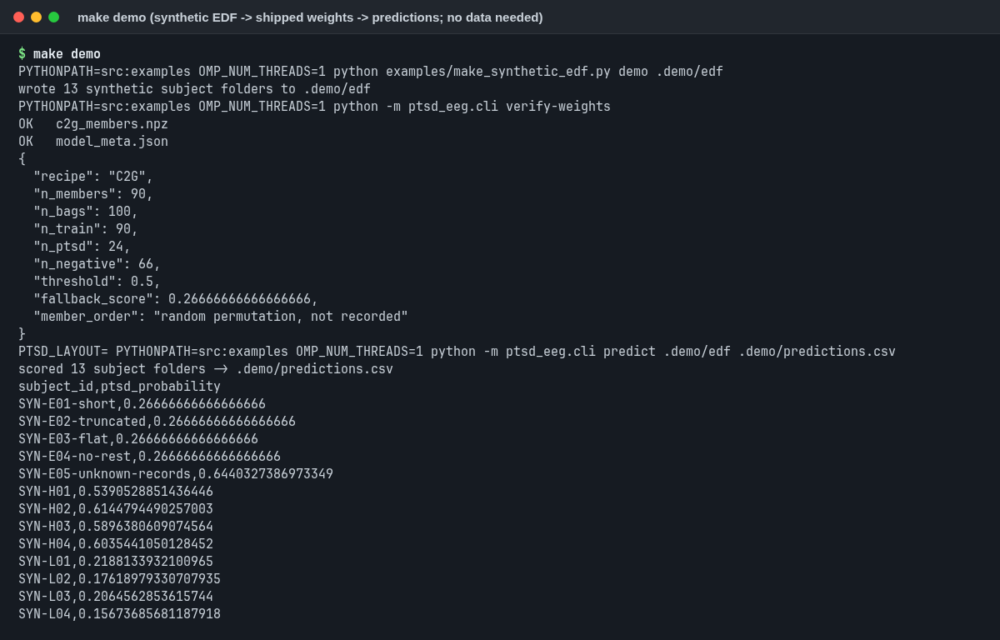 | 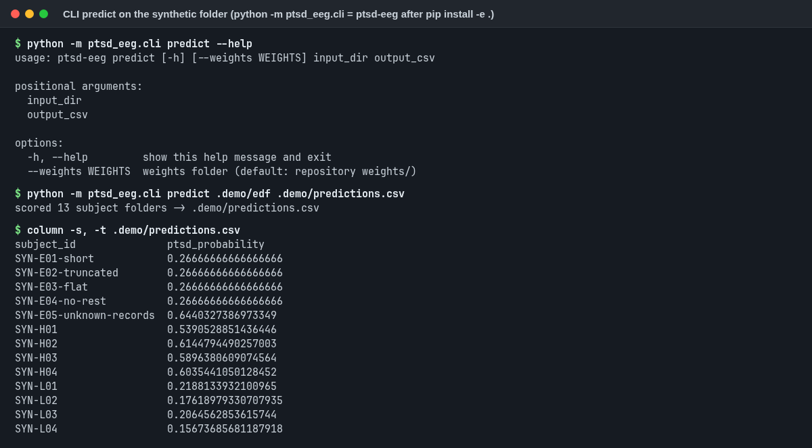 |
| `make demo` on synthetic subjects, including gated short, truncated, flat and missing rest files. | `ptsd-eeg predict` (run as `python -m ptsd_eeg.cli`) on the synthetic folder. |
| 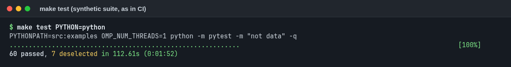 | 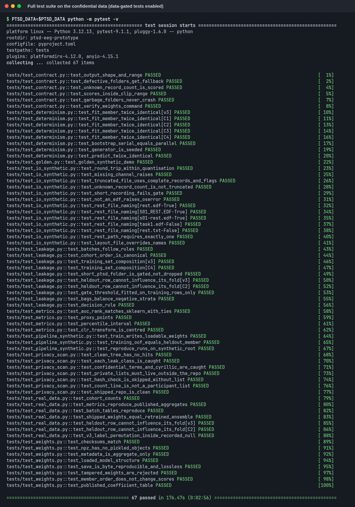 |
| `make test` (synthetic, runs in CI). | Full test suite run locally on the real data (names and counts only). |
| 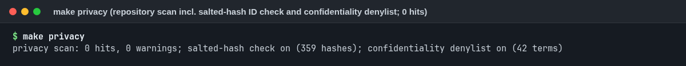 | 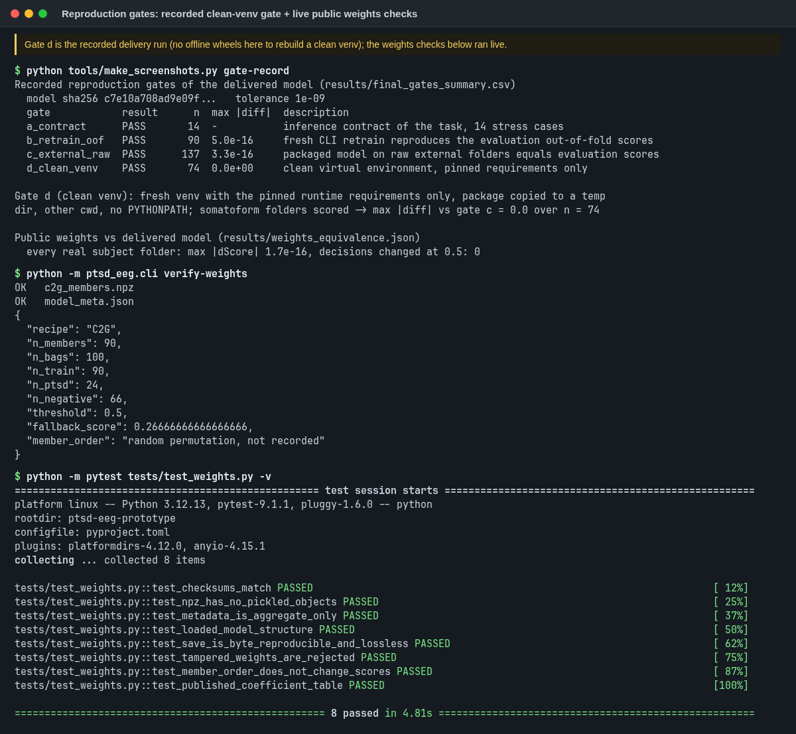 |
| `make privacy`: 0 hits with the salted-hash subject-ID check and the confidentiality denylist on. | The *recorded* clean-venv gate of the delivered model (max difference 0.0, n = 74) re-rendered from `results/`, plus live weight checks; the clean venv was not rebuilt for this screenshot. |
| 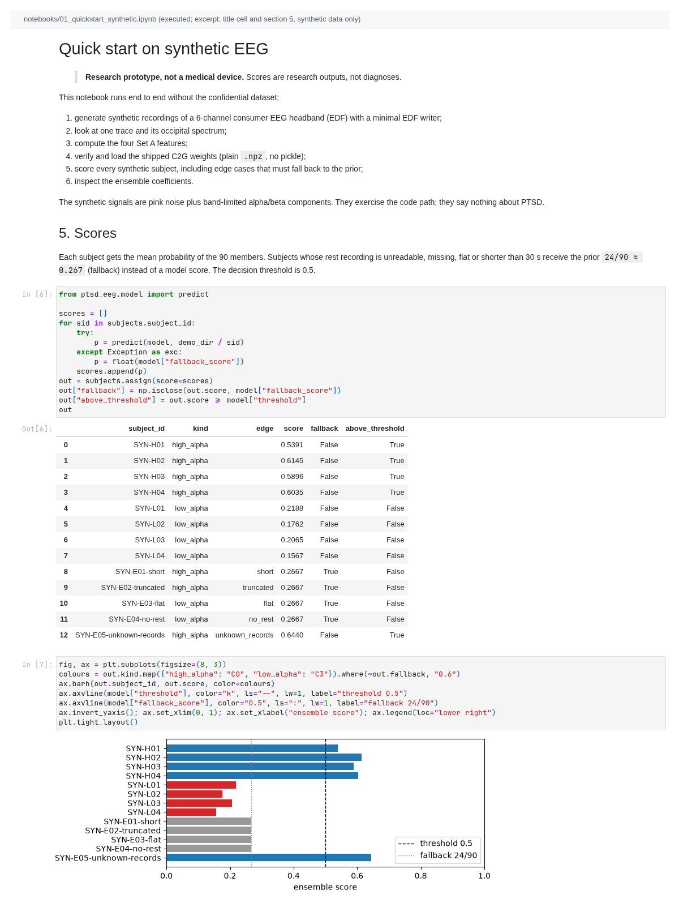 | |
| Notebook 01, the synthetic quickstart. | |

## Quickstart

Requires Python 3.12 (3.11+ works; the pinned versions were built with 3.12.13). No project data are needed for
anything in this block.

```bash
git clone https://github.com/zititank/ptsd-eeg-prototype.git
cd ptsd-eeg-prototype
python3.12 -m venv .venv && source .venv/bin/activate
pip install -r requirements.lock && pip install -e .

make demo          # writes 13 synthetic subjects to .demo/edf/ and scores them -> .demo/predictions.csv
make test          # synthetic test suite (the same one CI runs)
make privacy       # privacy scan, 0 hits required (private lists are used when present)
make figures       # rebuilds every figure from the aggregate CSVs in results/
make animations    # rebuilds the animations in media/ (needs ffmpeg)
make numbers       # tools/check_numbers.py: every key number in the docs vs results/
make links         # tools/check_links.py: relative links, anchors and images in the docs

# the `ptsd-eeg` command exists after `pip install -e .`
ptsd-eeg verify-weights                             # checksums of weights/ and the model metadata
ptsd-eeg predict .demo/edf my_predictions.csv       # any folder of subject folders

# without installing the package: the same CLI as a module (run from the repository root)
PYTHONPATH=src python -m ptsd_eeg.cli verify-weights
PYTHONPATH=src python -m ptsd_eeg.cli predict .demo/edf my_predictions.csv
```

The Makefile calls `python` (override with `PYTHON`). With the venv activated that is the venv's interpreter;
without activating it, run for example `make demo PYTHON=.venv/bin/python`. The Makefile runs the code from `src/`
directly, so `pip install -e .` is only needed for the `ptsd-eeg` command; after installing, the `PYTHONPATH=src`
prefix is not needed either.

`ptsd-eeg predict [--weights DIR] INPUT_DIR OUTPUT_CSV` scores every subject folder inside `INPUT_DIR` and writes
one row per folder (`subject_id,ptsd_probability`). The demo set has four high-alpha subjects (`SYN-H01` to
`SYN-H04`, scored above 0.5), four low-alpha subjects (`SYN-L01` to `SYN-L04`, below 0.5) and five edge cases:
`SYN-E01-short`, `SYN-E02-truncated`, `SYN-E03-flat` and `SYN-E04-no-rest` get the fallback 0.267, while
`SYN-E05-unknown-records` (header record count -1, data complete) is scored normally. To write the synthetic set
somewhere else: `python examples/make_synthetic_edf.py demo my_synthetic/`.

The original data are confidential and not available ([DATA_ACCESS.md](DATA_ACCESS.md)). The data-gated targets
exist for the author and for any reviewer granted access under the data agreement; `LAYOUT` points to a private
JSON file with the dataset's folder names (see [`src/ptsd_eeg/layout.py`](src/ptsd_eeg/layout.py)):

```bash
make test-full DATA=/path/to/data LAYOUT=/path/to/layout.json   # adds the data-gated tests
make reproduce DATA=/path/to/data LAYOUT=/path/to/layout.json   # retrains nested LOSO, compares with results/metrics.csv
```

The three reproducibility levels (demo, figures, full retrain) are described in
[docs/reproducibility.md](docs/reproducibility.md).

## Repository map

| Path | Contents |
|---|---|
| [`src/ptsd_eeg/`](src/ptsd_eeg/) | EDF reader, data layout, QC and gate, features, transforms, model, metrics, bootstrap, gates, CLI |
| [`weights/`](weights/) | the 90-member ensemble as plain arrays (`.npz`), metadata and checksums; no subject identifiers |
| [`results/`](results/) | model-metric aggregates only (metrics, criteria, batch tables, external check, coefficients, gates); provenance in [`results/MANIFEST.csv`](results/MANIFEST.csv) |
| [`protocols/`](protocols/) | SHA-256 hashes of the pre-registered protocols and a summary of the decision rule |
| [`examples/`](examples/) | minimal EDF writer and the synthetic 6-channel headband generator used by the demo and tests |
| [`notebooks/`](notebooks/) | 01 synthetic quickstart, 02 results and figures from aggregates (executed, outputs committed) |
| [`figures/`](figures/), [`screenshots/`](screenshots/), [`media/`](media/) | everything embedded in this README; `media/` holds the animations (MP4, GIF previews, posters) and the banner |
| [`tests/`](tests/) | synthetic tests (CI) and data-gated tests (skipped without data) |
| [`tools/`](tools/) | privacy scan, number checker, figure, animation and screenshot builders |
| [`docs/`](docs/) | the story, a plain-language explanation, science, pipeline, data integrity, model selection, external check, limitations, references, reproducibility, glossary, TRIPOD+AI checklist, AI-assistance disclosure, development history, review guide |
| [MODEL_CARD.md](MODEL_CARD.md) | intended use, out-of-scope use, metrics by subgroup |
| [ETHICS.md](ETHICS.md), [DATA_ACCESS.md](DATA_ACCESS.md), [DISCLAIMER.md](DISCLAIMER.md) | data protection, misuse, confounding; data confidentiality; medical disclaimer |
| [CHANGELOG.md](CHANGELOG.md), [CITATION.cff](CITATION.cff), [LICENSE](LICENSE), [CONTRIBUTORS.md](CONTRIBUTORS.md) | release history, how to cite, MIT license, team and credits |

New to the code? Start with [docs/REVIEW_GUIDE.md](docs/REVIEW_GUIDE.md), then [docs/glossary.md](docs/glossary.md).
How the project got here, including why this repository starts with a fresh git history:
[docs/development_history.md](docs/development_history.md).

## Limitations (summary)

Each item has a number and a source in [docs/limitations.md](docs/limitations.md).

1. Batch artefact: AUC 0.816 overall vs 0.435 [0.256, 0.604] against valid controls.
2. Small sample: 24 scorable PTSD patients; sensitivity 5/24.
3. Specificity: 13/97 somatoform and 65+ recordings flagged; adding the task-duration feature would flag 0.826 of
   the 65+ group.
4. External check null and underpowered: ρ −0.04 [−0.63, 0.59], n = 15, eyes open.
5. One data source, one consumer headband, six channels, eyes-closed rest only; no age, medication or sleep data
   for patients.
6. No probability calibration; the score is a ranking, not a probability of disease.
7. For context, a larger resting-EEG PTSD study (n = 202, eyes closed and open) reported balanced accuracy up to
   62.9% (Li et al. 2022, see [docs/references.md](docs/references.md#l1)).

## Ethics and data

The data are confidential under the hackathon's data agreement, are not included and are not available from us.
No raw EEG, no EEG-derived data descriptions, no per-subject rows and no subject identifiers are in this repository;
only aggregate model metrics are. The public weights contain no identifiers; the one residual risk (comparing
leave-one-out members) is explained in [ETHICS.md](ETHICS.md). Details: [DATA_ACCESS.md](DATA_ACCESS.md).

## How to cite

If you use this code, please cite the repository (a `CITATION.cff` is included):

```bibtex
@software{ptsd_eeg_prototype_2026,
  author  = {{Bogdan (zititank)} and {AdetyTy} and {Qwertyqwerty579}},
  title   = {ptsd-eeg-prototype: a nested-LOSO resting-EEG pipeline and an honest negative result},
  year    = {2026},
  version = {4.1.1},
  url     = {https://github.com/zititank/ptsd-eeg-prototype}
}
```

Please also cite the public dataset used in the external check (du Bois et al. 2022, CC BY 4.0) if you rerun it.
All references are in [docs/references.md](docs/references.md).

## Contributing

Issues and pull requests are welcome, especially reports of errors in the docs or the code. Before opening a pull
request, run `make test`, `make privacy`, `make numbers` and `make links`; CI runs the same checks plus `make demo`. Never add raw
EEG, per-subject rows, subject codes or recording dates, even from your own data: the privacy scan will fail.

## Team

| Who | GitHub | Role |
|---|---|---|
| Bogdan (zititank) | [@zititank](https://github.com/zititank) | Author and maintainer: scientific backbone, pipeline, audits, pre-registration, presentation and oral defense |
| AdetyTy | [@AdetyTy](https://github.com/AdetyTy) | ML and data engineer - model training/verification, data stabilization, results interpretation |
| Qwertyqwerty579 | [@Qwertyqwerty579](https://github.com/Qwertyqwerty579) | Hackathon team-lead - ML and data, workflow verification, architecture design |

The project reached the oral defense stage of an international medical AI hackathon (name withheld under the data
agreement). The organisers and the people who recorded the data are not named, for the same reason. Development
was heavily AI-assisted: see [docs/ai_assistance.md](docs/ai_assistance.md). Credits and acknowledgements:
[CONTRIBUTORS.md](CONTRIBUTORS.md).

## License

Code and weights: [MIT](LICENSE), © 2026 Bogdan (zititank). The license does not make the model fit for clinical use; see
[DISCLAIMER.md](DISCLAIMER.md) and [MODEL_CARD.md](MODEL_CARD.md).
