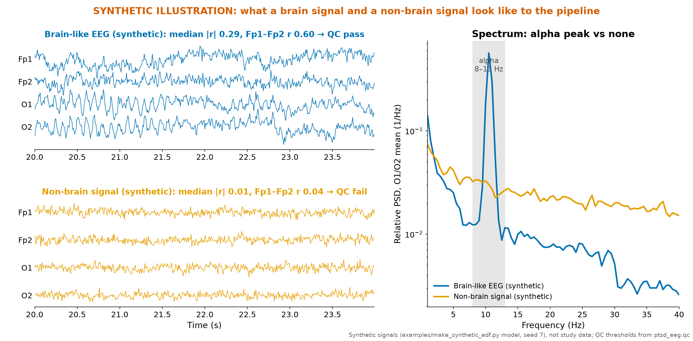

# Data integrity audit

Short public summary of the audit run before any v4 candidate was fitted. Thresholds were written into the audit
script before any group table was produced, and no subject was relabelled or dropped because of its outcome. The
data are confidential ([DATA_ACCESS.md](../DATA_ACCESS.md)), so the audit's per-batch signal statistics, file
metadata and defect lists stay private; this page gives the conclusions and the model-level checks.

## Verdict

- **The data were not damaged in transfer.** The files are byte-identical across independent snapshots, and the
  rest-file signals match the hashes recorded by the earlier model version.
- **The source data contain real defects**, present from the moment they were delivered. The one that matters:
  control batch B (46 of the 66 training controls) contains no physiological EEG.

## 1. Control batch B is not EEG

The audit's checks are label-free. On real scalp EEG, neighbouring electrodes are strongly correlated (the two
frontal electrodes see every blink) and eyes-closed rest shows an alpha peak. In control batch B none of the 46
rest files has an alpha peak (46/46), and the batch fails the audit's other label-free checks as well.

The most likely explanations are recording without skin contact, a grounding fault, or a different export tool.
That is our hypothesis, not an established fact; what would settle it is listed in
[limitations.md](limitations.md#data-that-would-change-our-conclusions).

The figure shows the pattern on **synthetic** signals only; no data of the cohort are plotted.

## 2. What this does to any classifier

| Check | Result |
|---|---|
| v3 AUC, PTSD vs control batch B only | 0.896 [0.768, 1.000] |
| v3 AUC, PTSD vs valid controls only | 0.410 [0.235, 0.577] |
| v3 refitted without control batch B | 0.273 [0.125, 0.431] |
| v3 refitted without the valid controls | 0.933 [0.840, 1.000] |
| Set A EEG features separating batch B from valid controls (healthy vs healthy) | AUC 0.85 |
| EDF header fields alone predicting PTSD vs control | AUC 0.970 |

A PTSD marker cannot separate one healthy batch from another, and header fields cannot carry biology. Both
negative controls point to acquisition. Removing the batch removes the effect.

## 3. Other defects, in brief

The audit also found a few smaller defects (for example duplicated or too-short recordings and one suspect
channel in control set C). Each has a predeclared handling below.

## 4. Consequences we acted on

1. Report the AUC against valid controls next to every headline AUC (pre-registered honesty clause).
2. Stratum-balanced bagging in C2, so control batch B cannot dominate training by size.
3. Count the fully duplicated somatoform pair once in a predeclared sensitivity analysis.
4. Score control set C with O1 only as a predeclared sensitivity analysis.
5. A minimum-data gate for rest files under 30 s or truncated (Amendment 1, release v4.1).
6. Keep the task-duration feature out of the model: it cannot be validated on the expanded controls.
