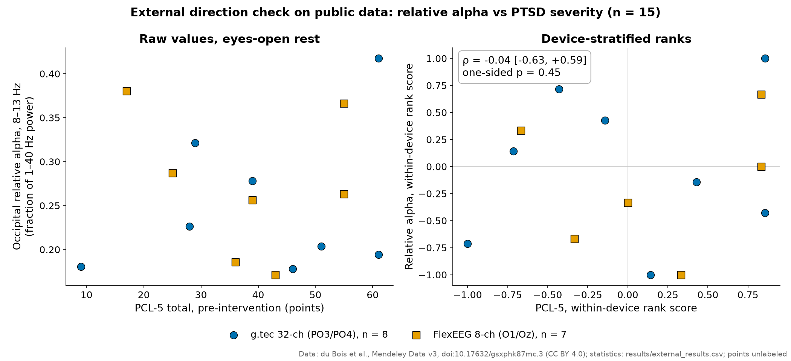

# External direction check on public data

**Result: null and underpowered.** In 15 trauma-exposed women from a public dataset, occipital relative alpha
computed with our frozen feature code showed no relation to PTSD severity (PCL-5): device-stratified Spearman
ρ −0.04, bootstrap 95% CI [−0.63, 0.59], one-sided permutation p = 0.45. The shipped model's score was also
unrelated to PCL-5 (ρ +0.005, p = 0.99). There is no external support for the model's "more alpha = more PTSD"
direction, and no evidence against the literature direction either.

## Pre-registration

- Protocol hashed before any download (SHA-256 `44d869a0…c07a`).
- Amendment hashed after the file layout was inspected and before any PCL-5 value was read (SHA-256
  `bfa1a059…79eb`).
- Both hashes and a summary are in [`protocols/README.md`](../protocols/README.md); the texts are not published
  because they also describe the confidential training data.
- Run constants and hashes: [`results/external_run_meta.json`](../results/external_run_meta.json); all statistics:
  [`results/external_results.csv`](../results/external_results.csv).
- Primary hypothesis (one-sided, from the literature): more PTSD severity goes with less occipital relative alpha.

## Data

| Dataset | Outcome |
|---|---|
| du Bois et al., "EEG and psychological assessment datasets: Neurofeedback for the treatment of PTSD", Mendeley Data v3, doi:10.17632/gsxphk87mc.3, CC BY 4.0 | used |
| Queensland University of Technology post-traumatic growth EEG, doi:10.25912/RDF_1684466012814 | access by negotiation only; not obtained |

- EEG exists for the two treatment groups only (the controls have none). We used the pre-training rest of session 1.
- **Eyes-open rest only**; our device protocol is eyes-closed, so alpha levels are not comparable.
- Participants without session 1 were excluded (they appear only in a sensitivity analysis). Two uploads with an
  identical signal matrix were both excluded.
- **n = 15**, on two devices: 8 on a 32-channel cap without O1/O2 (PO3/PO4 used instead) and 7 on an 8-channel
  device (O1 and Oz used). Device and treatment group coincide, so the primary statistic is stratified by device.
- Device emulation: resample to 125 Hz, 2–40 Hz zero-phase band-pass, then the frozen feature code unchanged.
- Resampling as predeclared: 5000 bootstrap and 20000 permutation draws.

## Results

| Test | n | ρ | 95% CI | p | Holm p |
|---|---|---|---|---|---|
| **Primary:** relative alpha O vs PCL-5 (one-sided) | 15 | −0.04 | [−0.63, 0.59] | 0.45 | – |
| IAF | 11 | +0.21 | [−0.71, 0.92] | 0.56 | 1.00 |
| Relative alpha in IAF ± 2 Hz | 11 | +0.21 | [−0.52, 0.95] | 0.55 | 1.00 |
| Relative beta O | 15 | −0.33 | [−0.79, 0.31] | 0.26 | 0.77 |
| Model score (descriptive) | 15 | +0.005 | [−0.55, 0.56] | 0.99 | – |

IAF was undetected in 4 eyes-open recordings, hence n = 11.

Sensitivity analyses of the primary did not change the picture: first 60 s only ρ −0.17 (p = 0.28); PO7/PO8
instead of PO3/PO4 ρ −0.20 (p = 0.24); adding later-session participants ρ −0.16 (p = 0.26, n = 18). One
sensitivity value reached nominal significance (IAF on the first 60 s, ρ −0.66, p = 0.03); it is uncorrected and
inconsistent with the main analysis, so we do not interpret it.

The minimum detectable |ρ| at n = 15 (one-sided α 0.05, power 0.8) is about 0.66.

## Limitations of this check

- n = 15 split across two devices; only very large correlations were detectable.
- Eyes-open instead of eyes-closed; different montage and reference.
- A different population (women, decades after genocide trauma) and a within-patient severity range rather than
  patients vs controls.
- The better test (eyes-closed, about 30 people) needs a data request to the QUT authors.

We do not publish participant codes from the public dataset; see the original record for per-participant data.
