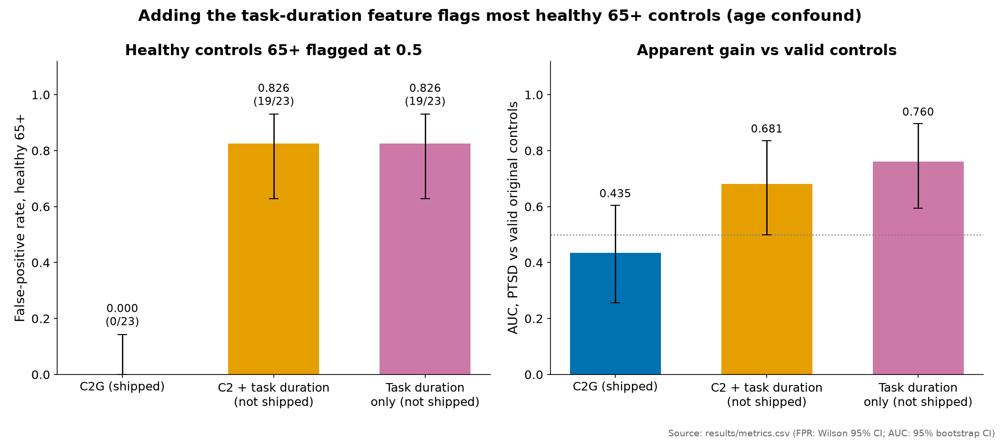

# Limitations

Each limitation comes with the number that shows it and where the number lives. Read this before reading any
result as a finding.

## The limitations

1. **The headline AUC is a batch artefact.** AUC 0.816 [0.750, 0.875] against all training controls, 0.982
   [0.937, 1.000] against control batch B alone, and 0.435 [0.256, 0.604] against the 20 valid controls. Control
   batch B (46 of 66 training controls) has no alpha peak in any file (46/46).
   EDF header fields alone separate PTSD from controls with AUC 0.970. Source: `results/metrics.csv`,
   [data_integrity.md](data_integrity.md).
2. **The model's main weight contradicts the biology.** `clr_alpha_O` has mean weight +1.57 and is positive in 98.7%
   of 9000 fits: more alpha scores as more PTSD-like. The literature predicts less or unchanged posterior alpha in
   PTSD. Source: [science.md §6](science.md#6-weights-what-the-model-actually-uses).
3. **Small sample, low sensitivity.** 24 scorable PTSD patients; sensitivity at 0.5 is 5/24 (v3: 9/24). With about
   24 patients vs 20 valid controls, only large effects (d around 0.85 or more) are detectable at 80% power.
   Cross-validated metrics at this size carry wide error bars [B53].
4. **Specificity is not solved.** The shipped model flags 13/97 somatoform and 65+ recordings (0.134 [0.072,
   0.206]) and 7 of 20 scorable valid controls. Adding the task-duration feature would raise the 65+
   false-positive rate to 0.826.
   Source: `results/metrics.csv`, `results/C2G_batch_table.csv`.
5. **Age and sex confounding.** PTSD ages are not recorded per person; controls skew young; the model's inputs
   predict age within all controls with R² 0.154 [0.013, 0.268]. Sex composition differs between groups and is not
   recorded per person.
   The clearest case is the task-duration variant (figure below): it looked better against valid controls but
   flagged most healthy people aged 65+, so it was not shipped.

   

   *Adding the task-duration feature raises AUC vs valid controls (0.435 → 0.681 / 0.760) but flags 19/23
   healthy controls aged 65+ (FPR 0.826 vs 0.000): an age confound. Source: `results/metrics.csv`.*
6. **The external check is null and underpowered.** ρ −0.04 [−0.63, 0.59], p = 0.45, n = 15, eyes open, two
   devices; the minimum detectable |ρ| was about 0.66. Source: `results/external_results.csv`,
   [external_check.md](external_check.md).
7. **No event-related feature.** An exploratory event-related analysis was negative.
8. **Drowsiness is a plausible hidden driver.** Within the PTSD group, low scores go with low alpha and frequent
   alpha dropout, the drowsiness profile [H11, H15]. Sleep was not recorded, so this is a hypothesis without a
   published number here.
9. **One data source, one consumer headband, six channels, eyes closed only.** No midline or parietal electrodes, no eyes-open
   block, a 2–40 Hz hardware band. Most published PTSD alpha effects are eyes-open [H1, H4, H5].
10. **Clinical overlays are undocumented.** Medication (benzodiazepines lower alpha and raise beta [H20, H21]),
    mild head injury (slows alpha [H22]), alcohol (raises beta [B41]), sleep loss and depression are all common
    in PTSD and move the same features.
11. **No calibration study.** The score is a ranking with a fixed threshold, not a probability of disease; it was
    never calibrated on any population.
12. **Four candidates, no multiplicity correction.** Stated in the protocol and in [model_selection.md](model_selection.md).
13. **The clean-container test was substituted.** Docker was unavailable; a clean virtual environment reproduced the
    scores with maximum difference 0.0 instead.

## Context: what others achieved

The largest comparable study we know of (Li et al. 2022 [L1]; n = 202; 5 min eyes closed and 5 min eyes open;
research-grade EEG) reported balanced accuracy up to 62.9% for PTSD vs controls. Our dataset is smaller, recorded
with a 6-channel consumer headband and eyes closed only, and confounded by acquisition. A realistic ceiling for a clean
version of our design is modest.

## Data that would change our conclusions

In order of value. Requests 1 and 2 are the only things that could change the scientific conclusion.

1. **Origin of control batch B and the closed test's controls.** Device, firmware, operator and export tool for
   the 46 recordings, a raw export, and whether the closed-test controls were recorded the same way. If the test
   controls resemble batch B, a high test AUC will be an artefact too.
2. **Patient metadata.** Individual age, current medication with doses and last intake, head-injury history, and
   PCL-5 or CAPS-5 scores. This would allow age- and medication-adjusted analyses and a dose–response test (less
   alpha with more hypervigilance [H4, H5]).
3. **Sex of every subject**, to separate diagnosis from sex effects on alpha frequency [H13].
4. **Direct task-performance measures** (errors and per-trial timing) instead of a duration proxy.
5. **Eyes-open rest** from the same people, to test the leading literature hypothesis and alpha reactivity.
6. **About 20 new controls recorded on the patients' device**, by the same operator, protocol and time of day: the
   first device-matched comparison.
7. **Access to the QUT eyes-closed PTSD dataset**, to rerun the pre-registered external check with more power.

We also sent the data provider our other data-quality questions (see [data_integrity.md](data_integrity.md)
section 3).

## Next steps

1. Get answers to requests 1 and 2.
2. Record about 20 device-matched controls.
3. Rerun the external check on the QUT data.
4. Optional: probability calibration and a task learning-curve analysis (dropped for time; they do not affect the
   decision).
5. Pre-register the next hypothesis with a power calculation: d = 0.5 needs about 64 per group for 80% power.
