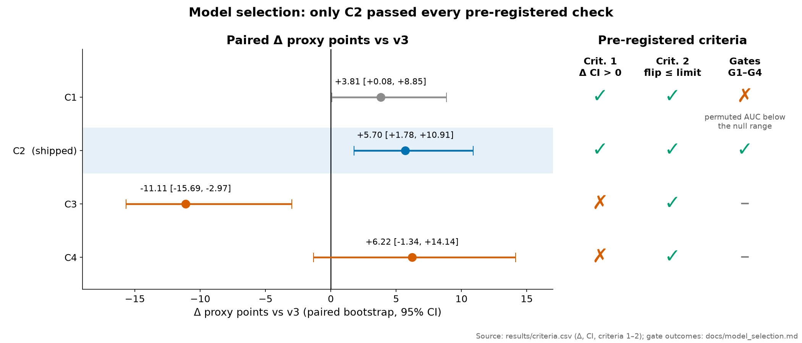
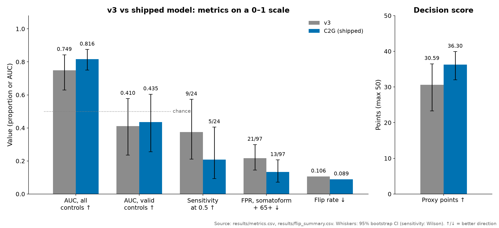

# Model selection

How the shipped model was chosen, with the rule fixed before any candidate was scored. Translated and condensed
from the private handover. The protocol texts describe the confidential data and are not published; their hashes
and a summary of the rule are in [`protocols/README.md`](../protocols/README.md).

## Order of steps and hashes

| Step | Evidence |
|---|---|
| v3 (hackathon submission) audited: data integrity and instability | [data_integrity.md](data_integrity.md) |
| PROTOCOL_v4 written and hashed before any candidate was fitted | [`protocols/README.md`](../protocols/README.md), SHA-256 `88ef6934f896d83ac2b5fa3e1f7c5a7e3ee6ad1cfe70bc97cf5a6f956a5bb047` |
| Candidates C1–C4 evaluated, decision rule applied, C2 shipped as v4.0 | [`results/criteria.csv`](../results/criteria.csv), [`results/metrics.csv`](../results/metrics.csv) |
| Amendment 1 (minimum-data gate) written and hashed before the gate was implemented | [`protocols/README.md`](../protocols/README.md), SHA-256 `38ad28a931699b6e3c284fccff8e701df8724bc2f6475254a79ee1f6217c83d8` |
| C2G shipped as v4.1 | row `C2G` in [`results/metrics.csv`](../results/metrics.csv) |

The hashes above are those of the original files, recorded when they were frozen
([reproducibility.md](reproducibility.md#pre-registration-hashes)).

## Fixed ingredients (identical for every candidate)

- The same 90 scorable training subjects (24 PTSD, 66 controls); the same evaluation groups.
- Set A features exactly as frozen in v3; no feature selection, no new features.
- The same inner shrinkage selector, LOSO outer loop, threshold 0.5 and fallback 24/90.
- No batch correction (ComBat or residualisation), no header or duration feature: batch is confounded with the
  label, so correcting it would remove the label too.

## Candidates

| Name | Change relative to v3 |
|---|---|
| C1 | robust transforms: CLR/logit per subject; in-fold winsorising 1/99 and robust scaling |
| C2 | C1 + stratum-balanced bagging (B = 100), output clipped to [0.02, 0.98] |
| C3 | C2 + inference-time gate: rest < 30 s, coupling-QC fail, or Mahalanobis distance above the fold's 99th percentile → fallback |
| C4 | C2 with somatoform subjects added as negatives in training |

## Decision rule

A candidate replaces v3 only if all three hold:

1. **Better score.** Proxy points = 30 · max(0, 2·AUC − 1) + 20 · (1 − FPR), where FPR is the positive rate among
   the 97 somatoform and 65+ folders. The paired bootstrap Δ vs v3 (2000 resamples shared by all models) must have
   its 2.5th percentile above 0.
2. **Not less stable.** Flip rate no worse than v3's plus 0.005. Flip rate = 200 class-stratified bootstrap refits
   of the whole training procedure; per subject, the share of refits on the minority side of 0.5; averaged over the
   159 scorable subjects outside control batch B (that batch never flips and would dilute the average).
3. **Safe.** Gates G1 (no leakage; label-permutation AUC inside the recorded null), G2 (batch table produced),
   G3 (14/14 inference-contract cases), G4 (inference and retrain reproduced within 1e-9).

If several pass, the highest proxy wins; if none passes, v3 stays. Nothing was re-tuned after results. Four
candidates were compared without multiplicity correction, which we state openly.

## Outcome

| Candidate | Proxy | Δ vs v3 [95% CI] | Criterion 1 | Flip rate (limit 0.1112) | Criterion 2 | Gates |
|---|---|---|---|---|---|---|
| v3 | 30.59 | – | – | 0.1062 | – | pass |
| C1 | 34.40 | +3.81 [+0.08, +8.85] | pass | 0.1064 | pass | **fail G1** |
| C2 | 36.30 | +5.70 [+1.78, +10.91] | pass | 0.0889 | pass | pass |
| C3 | 19.49 | −11.11 [−15.69, −2.97] | fail | 0.0691 | pass | not run |
| C4 | 36.82 | +6.22 [−1.34, +14.14] | fail | 0.0254 | pass | not run |

- **C1** failed G1 because its permuted AUC fell below the null range. Leave-one-out AUC is negatively biased under
  the null, so this is not evidence of leakage, but the protocol required the value to lie inside the range.
- **C2** passed everything: permuted AUC 0.349 inside [0.142, 0.580], contract 14/14, inference reproduced within
  3.3e-16, retrain within 5.0e-16. **C2 shipped.**
- **C3**'s gate sent 0.366 of scorable subjects to the fallback, including most of control batch B, and its AUC
  fell to 0.519. **C4** reached the highest point estimate, but its lower CI bound was below zero.

## What C2 changed, and what it did not

| Metric | v3 | C2 / C2G |
|---|---|---|
| AUC, all training controls | 0.749 | 0.816 |
| AUC, valid controls | 0.410 | 0.435 |
| Sensitivity | 9/24 | 5/24 |
| FPR, somatoform + 65+ | 21/97 | 13/97 |
| Flip rate | 0.106 | 0.089 |

The gain comes from specificity, not from detecting PTSD. Against valid controls both models are at chance.

## Predeclared sensitivity analyses (shipped recipe)

| Analysis | Result |
|---|---|
| Exclude training subjects with an unusable rest file | none qualified; AUC 0.816, somatoform + 65+ FPR 0.167 (n = 78 usable), proxy 35.64 |
| Control set C scored with O1 only (suspect O2 channel, see [data_integrity.md](data_integrity.md)) | FPR 0.125 (5/40) vs 0.100 with O1 + O2 |
| Fully duplicated somatoform pair counted once | somatoform FPR 0.164 (n = 73), somatoform + 65+ FPR 0.125 (n = 96), proxy 36.48 |

## Amendment 1: the minimum-data gate (C2G, v4.1)

C2 scored truncated files as if they were complete (a rest file cut to a third still received an ordinary score in
the contract test). Amendment 1 added a label-free rule: rest shorter than 30 s, or a data section shorter than the
EDF header declares, gets the fallback 24/90. Acceptance was on safety only: fold members identical to C2, every
ungated score bit-identical, the truncated-file contract case now returning 24/90, and all gates passing. The gate
fired for 1 subject (an evaluation-only young control, not a training subject), the decision was unchanged, and no
metric changed.
