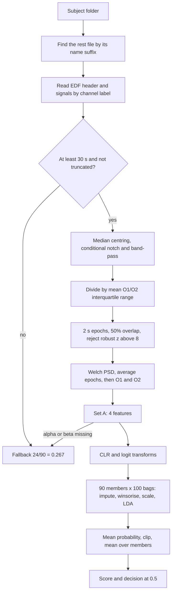
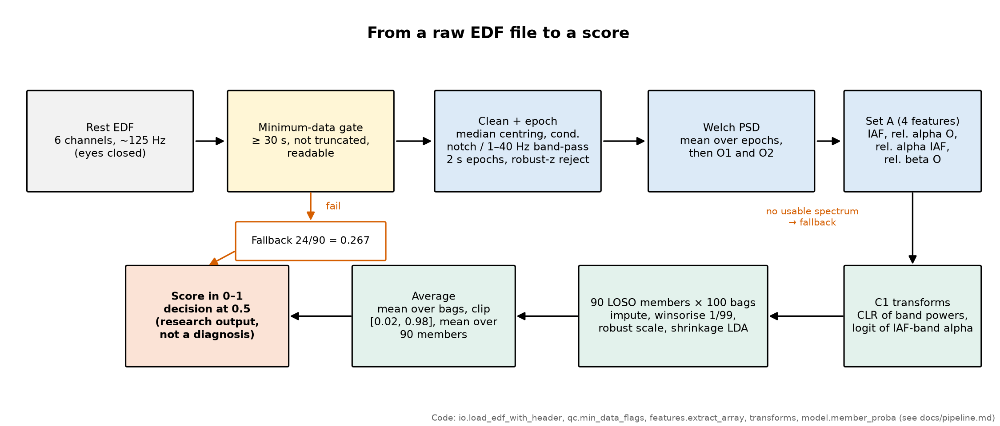
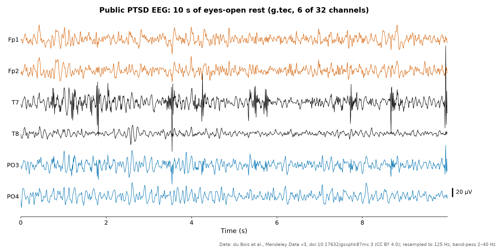
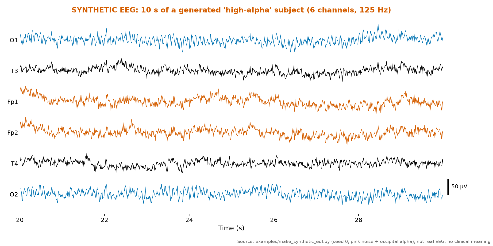

# Pipeline, stage by stage

From one subject folder to one score. Scientific rationale is in [science.md](science.md); this page is the
engineering view, with the function that implements each stage.

*The same pipeline as a static figure: minimum-data gate (fallback 24/90), cleaning and epoching, Welch PSD, the
four Set A features, C1 transforms, the 90 × 100 bagged shrinkage-LDA ensemble, decision at 0.5.*

| Stage | What and why | Function |
|---|---|---|
| Locate rest file | exactly one `.edf` whose stem ends in the layout's rest suffix (`rest` by default, case-insensitive; see `src/ptsd_eeg/layout.py`) | `io.rest_path` |
| Read EDF | own minimal reader, channels picked by label, sampling rate read per file (it can differ between files) | `io.load_edf_with_header` |
| Minimum-data gate | duration = complete records × record length; truncated if the data section is shorter than the header declares; either → fallback | `qc.min_data_flags` |
| Clean | median centring; 50 Hz notch only with a clear spike; 1–40 Hz band-pass only if ≥ 5% of power lies outside | `features.preprocess_rest` |
| Gain normalisation | all channels divided by the mean O1/O2 interquartile range, because device gains differ between batches | `features.normalized_epochs` |
| Epochs and rejection | 2 s epochs, 50% overlap; drop epochs with robust z > 8 in amplitude or variance | `features.normalized_epochs` |
| Spectrum | Welch PSD per epoch; mean over epochs, then over O1 and O2 | `features.welch_epochs`, `features.mean_channel_psd` |
| Features | IAF (7–14 Hz peak ≥ 1.5 × baseline), relative alpha 8–13 Hz, relative alpha IAF ± 2 Hz, relative beta 13–30 Hz; denominator 1–40 Hz (effectively 2–40 Hz given the hardware band) | `features.rest_spectral_features` |
| Scorable? | at least one clean epoch and finite relative alpha and beta; missing IAF is allowed (imputed) | `features.extract_array` |
| Transforms | CLR of (alpha, beta, rest), logit of IAF-band alpha, IAF unchanged | `transforms.c1_subject_transform` |
| Member scoring | per bag: impute with fold median, clip to fold 1st/99th percentile, robust scale, LDA; mean over 100 bags, clip [0.02, 0.98] | `model.member_proba` |
| Ensemble | mean over 90 members; invalid output raises an error instead of returning a number | `model.score_record` |
| Folder run | one row per subject folder; any failure for one subject → fallback, the run continues | CLI `predict` |

## Why these engineering choices

- **Own EDF reader.** Avoids a dependency and lets the gate read header record counts and file size directly.
- **Conditional filters.** Some batches were already filtered; filtering twice would distort the spectrum.
- **Gain normalisation on O1/O2.** Physical scaling in the EDF headers differs between batches; relative powers are
  unaffected, but epoch rejection needs comparable amplitudes.
- **Fallback below threshold.** A recording that cannot be scored should never produce a positive decision.
- **No age, header or duration inputs.** These separate the groups by acquisition, not by biology.

## What the traces look like

| | |
|---|---|
|  |  |
| Ten seconds from a public recording (du Bois et al., CC BY 4.0), resampled to 125 Hz and band-passed 2–40 Hz. | Ten seconds of a synthetic subject from `examples/make_synthetic_edf.py`. |

We never show raw EEG of our subjects.
