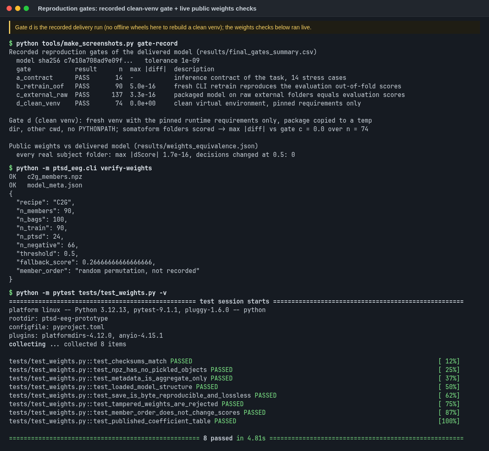
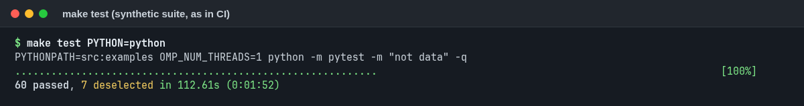
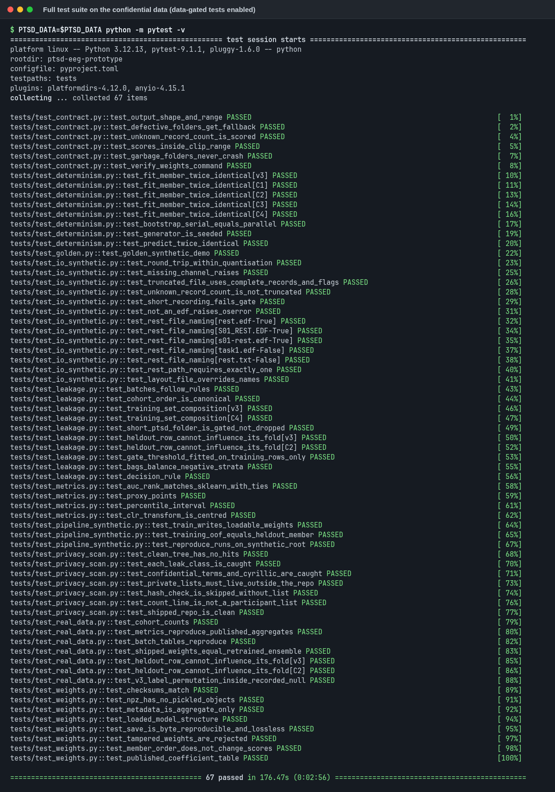
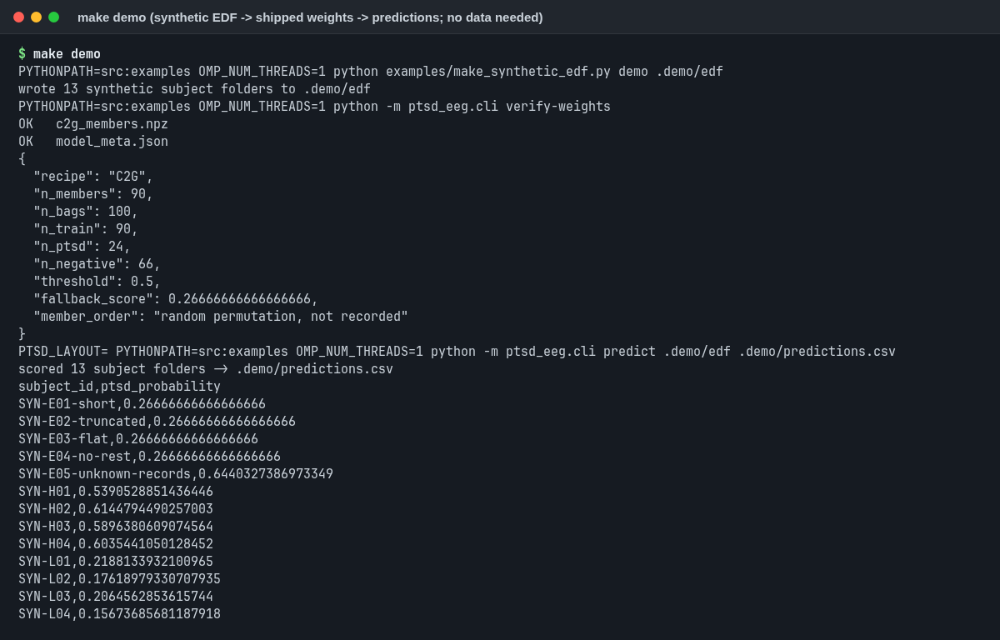
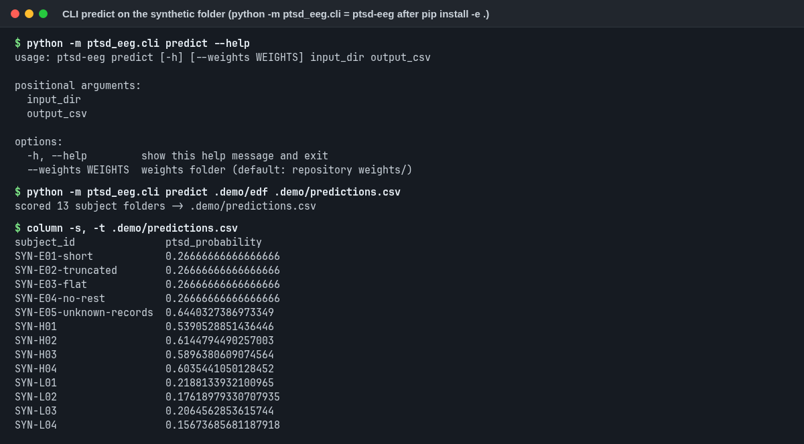
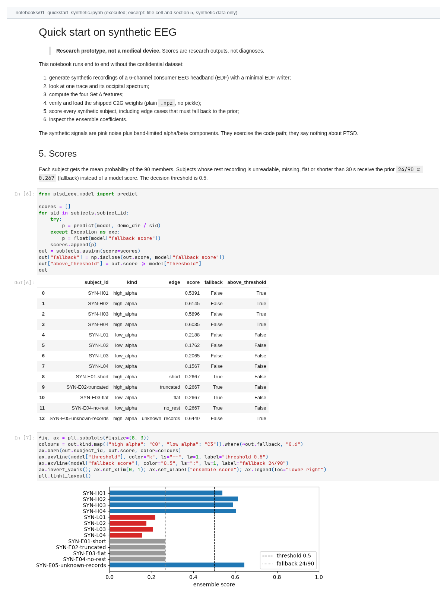
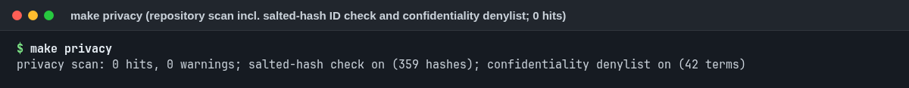

# Reproducibility

Three levels, from "no data at all" to "bit-level retrain". Each level has a single command.

| Level | Needs | Command | What you get |
|---|---|---|---|
| 1. Demo | nothing | `make demo`, `make test` | synthetic EDF subjects scored by the shipped weights; the gate fires on the short and truncated files; synthetic test suite |
| 2. Figures | nothing | `make figures` | every figure and table rebuilt from the aggregate CSVs in `results/` |
| 3. Full retrain | the original data, which are confidential ([DATA_ACCESS.md](../DATA_ACCESS.md)), and their private layout file | `make reproduce DATA=/path LAYOUT=/path/layout.json` | nested-LOSO retrain from raw EDF, then a comparison with `results/metrics.csv` |

## Environment

- Python 3.12 (built and tested with 3.12.13).
- Pinned runtime: numpy 1.26.4, pandas 3.0.5, scipy 1.17.1, scikit-learn 1.9.0 (`requirements.lock`).
- Set `OMP_NUM_THREADS=1`; the Makefile does this. Multi-threaded BLAS can change the last bits of a result.

```bash
python3.12 -m venv .venv && source .venv/bin/activate
pip install -r requirements.lock && pip install -e .
make demo                        # uses `python`, i.e. the activated venv
make demo PYTHON=.venv/bin/python   # same, without activating the venv
ptsd-eeg --help                  # the console script, available after `pip install -e .`
PYTHONPATH=src python -m ptsd_eeg.cli --help   # the same CLI without installing the package
```

`requirements.lock` pins the runtime and the test/notebook tools (pytest, matplotlib, nbconvert). The Makefile
sets `PYTHONPATH=src:examples` and `OMP_NUM_THREADS=1` itself.

## Seeds

| Purpose | Seed |
|---|---|
| inner 5-fold split of outer fold *i* | 20260924 + *i* |
| bootstrap bags of outer fold *i* | 20260928 + *i* |
| flip-rate bootstrap refits (200) | 20260927 |
| evaluation bootstrap (2000 resamples, batch-stratified) | 20260928 |

## Evidence that it reproduces

| Check | Result |
|---|---|
| Fresh retrain from raw folders vs the evaluation's out-of-fold scores | max abs difference 5.0e-16, n = 90 |
| Shipped model on raw external folders vs stored predictions | max abs difference 3.3e-16, n = 137 |
| Clean virtual environment (only the pinned requirements, other working directory) | max abs difference 0.0, n = 74 |
| Inference contract (stress cases: missing files, bad headers, truncated and short files, etc.) | 14/14 pass |
| Public `.npz` weights vs the delivered pickle, on every real subject folder | max abs score difference 1.7e-16, no decision changed ([`results/weights_equivalence.json`](../results/weights_equivalence.json)) |

The first four rows are gates recorded when the model was delivered (`results/final_gates_summary.csv`); the last
row was computed for this repository. The docker daemon was unavailable on the build machine, so the clean virtual
environment replaced a container test.



*What this screenshot is and is not:* it re-renders the **recorded** clean-venv gate (d) from
`results/final_gates_summary.csv`, then runs the public-weights checks (`verify-weights` and
`tests/test_weights.py`) live. The clean virtual environment was **not** rebuilt for the screenshot: the build
machine has no offline wheel cache and installing packages was out of scope. To rerun the gate yourself, create a
fresh venv from `requirements.lock` in an empty folder and run `make demo` and `make test` there.

## What the tests cover

| | |
|---|---|
|  |  |
| `make test`: synthetic tests, run in CI. | Full suite on real data, run locally; data-gated tests skip without `PTSD_DATA` and `PTSD_LAYOUT`. |

- **Leakage:** perturbing a held-out subject leaves its fold member identical; imputers equal training-fold medians.
- **Gate:** short (< 30 s) and truncated files return exactly 24/90; untouched files keep bit-identical scores.
- **Golden output:** the synthetic subjects produce the stored scores.
- **Contract:** the CLI survives unreadable folders and always writes one row per subject.

| | |
|---|---|
|  |  |
| `make demo` | `ptsd-eeg predict` |
|  |  |
| `notebooks/01_quickstart_synthetic.ipynb` | `make privacy` |

## How numbers in the docs are checked

[`tools/check_numbers.py`](../tools/check_numbers.py) (`make numbers`, run in CI) does three things:

1. checks that [`results/c2g_coefficients.csv`](../results/c2g_coefficients.csv) and
   [`results/shrinkage_selection.csv`](../results/shrinkage_selection.csv) match the public weights in `weights/`;
2. recomputes more than 100 key numbers from `results/` (metrics, criteria, batch table, external check, gates,
   coefficients, audit tables), formats them as written and requires them in the named docs; a mismatch fails;
3. lists every other decimal number in the Markdown docs that matches no shipped source, for manual review.

Where each results file comes from is recorded in [`results/MANIFEST.csv`](../results/MANIFEST.csv).

[`tools/check_links.py`](../tools/check_links.py) (`make links`, run in CI) checks that every relative link, anchor
and image in the Markdown files and notebooks resolves, that repository paths written as inline code (such as
`results/metrics.csv`) exist, and that every PNG in `figures/` and `screenshots/` is embedded somewhere.

## Pre-registration hashes

The protocols were frozen by recording their SHA-256 before the analyses they govern
([model_selection.md](model_selection.md)). Their texts describe the confidential data, so this repository
publishes only the four original hashes and a summary of the decision rule
([`protocols/README.md`](../protocols/README.md)). The v4 protocol hash is also stored in every row of
`results/metrics.csv` and in `weights/model_meta.json`; `ptsd-eeg verify-weights` checks the latter. Anyone who is
later shown an original protocol can confirm it with `sha256sum`.

## Runtime

Measured on the build machine (4 cores, `JOBS=4`, `OMP_NUM_THREADS=1`):

| Command | Wall time |
|---|---|
| `make reproduce DATA=... LAYOUT=...` (read the data, nested LOSO of v3, C2 and C2G, bootstrap metrics, comparison) | about 1 min (65 s) |
| the same with `--flip` (adds 200 bootstrap refits per model for the flip rate) | about 4.5 min (261 s) |
| `make test` (synthetic suite) | about 1 min (40–56 s) |
| `make test-full DATA=... LAYOUT=...` (all tests incl. data-gated) | about 2–2.5 min (115–139 s) |
| `make demo` | about 3 s |

Both reproduce runs matched `results/metrics.csv` within 7.1e-15 (tolerance 1e-9).
