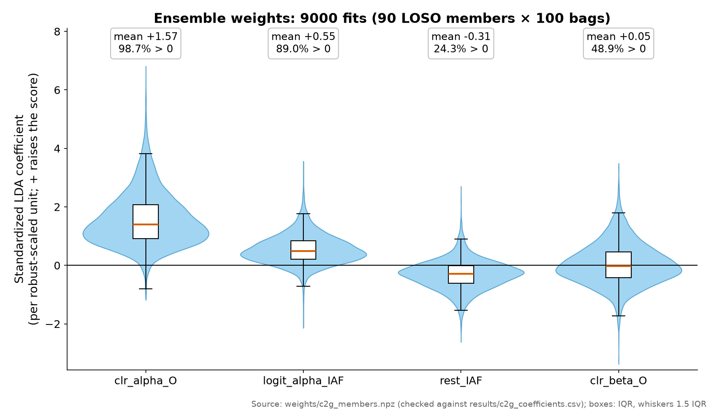
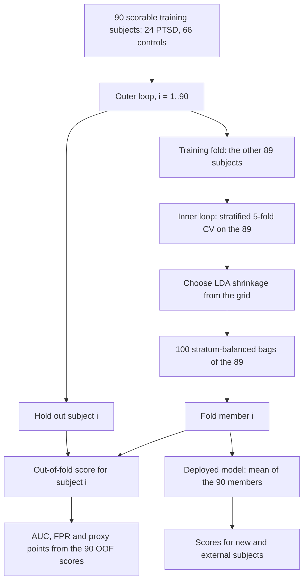
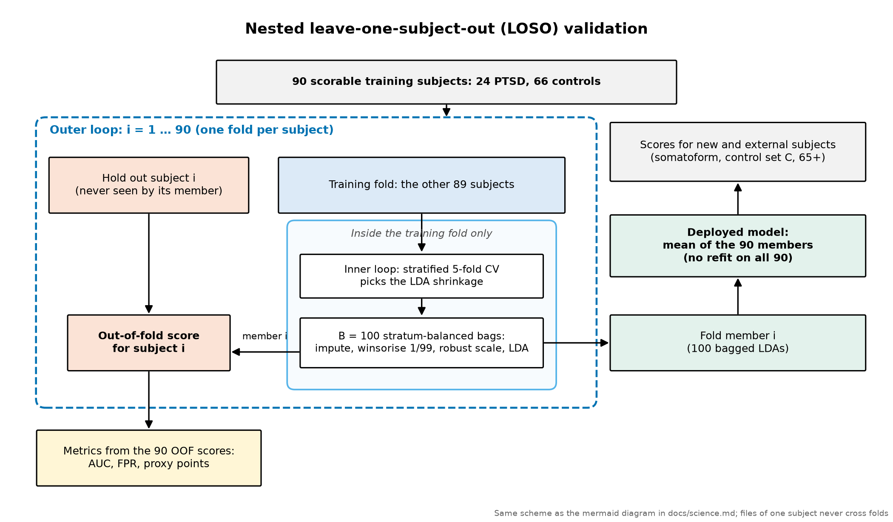
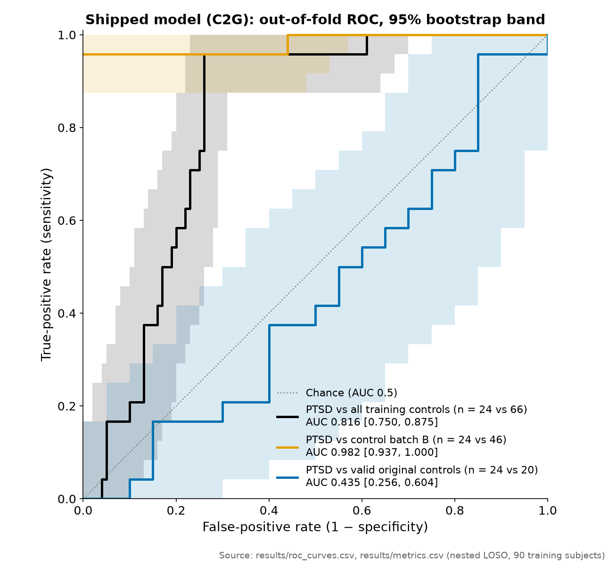

# Science: markers, model, validation

> Research prototype. Not a medical device. Not for diagnosis, screening or clinical decisions.

This is the scientific core of the project in one place: what the model measures, how it was trained and
validated, what the weights say, how the model was chosen, and what the results mean. Every number here is
checked against `results/*.csv` by a script (see [reproducibility.md](reproducibility.md)). Citation keys such
as [H1] or [B1] resolve in [references.md](references.md), which also says how each source was used.

## 1. The question and the short answer

**Question.** Can four resting-state EEG features from a 6-channel consumer EEG headband separate PTSD patients
from healthy controls, while giving low scores to somatoform patients and older adults?

**Short answer.** Not in these data. The shipped model reaches AUC 0.816 [0.750, 0.875] against all training
controls. That number is driven by one control batch ("control batch B", 46 of 66 training controls) whose
recordings contain no physiological EEG. Against the 20 physiologically valid training controls the AUC is
0.435 [0.256, 0.604], which is chance level. We found no EEG biomarker of PTSD here. What we built is a
carefully validated, reproducible pipeline and an honest account of why the headline number is not biology.

## 2. The recording

- **Device.** A 6-channel consumer EEG headband with dry electrodes: O1, O2 (occipital), T3, T4 (temporal), Fp1,
  Fp2 (frontal pole), ear reference. No midline or parietal channels.
- **Signal.** About 125 Hz sampling, 2–40 Hz hardware band.
- **Protocol per subject.** An eyes-closed resting recording (about 1 min) plus a timed attention task.
- **The model uses only the eyes-closed rest file.** No age, no header fields, no task timing, no file length.

## 3. The markers (Set A)

All four features come from the same occipital spectrum. The code is
[`src/ptsd_eeg/features.py`](../src/ptsd_eeg/features.py); the thresholds were fixed before any validation.

**Shared preprocessing** (functions `preprocess_rest`, `normalized_epochs`, `welch_epochs`, `mean_channel_psd`):

1. Subtract each channel's median.
2. Apply a 50 Hz notch only if a clear 50 Hz spike exists (at least 3 times the neighbouring bins).
3. Apply a 4th-order 1–40 Hz Butterworth band-pass only if at least 5% of the power lies outside 1–40 Hz.
4. Divide all six channels by the mean O1/O2 interquartile range (removes device gain differences).
5. Cut 2 s epochs with 50% overlap. Reject an epoch if its peak amplitude or variance has a robust z-score
   above 8 on any channel.
6. Welch power spectrum per epoch (2 s window, 50% overlap). Average over epochs, then over O1 and O2.

Relative power in a band is the trapezoid integral of that spectrum over the band divided by the integral over
1–40 Hz (`relative_bandpower`). Because the headset's hardware band starts at 2 Hz, the 1–2 Hz part of the
denominator is nearly empty, so in practice the denominator is 2–40 Hz power.

| Feature | Electrodes | Band / rule | Formula | What it reflects |
|---|---|---|---|---|
| `rest_IAF` | O1, O2 | peak search 7–14 Hz | frequency of the spectral maximum in 7–14 Hz, kept only if the peak is at least 1.5 times the median of the 7–14 Hz spectrum outside peak ± 1 Hz; otherwise missing (`find_iaf`) | individual alpha frequency, a stable trait that slows with age, drowsiness and head injury [H10, H11, H13, H22] |
| `rest_rel_alpha_O` | O1, O2 | 8–13 Hz | P(8–13) / P(1–40) | how much of the eyes-closed spectrum is alpha rhythm; alpha is the "idling / inhibition" rhythm of visual cortex [B17, B18] |
| `rest_rel_alpha_IAF` | O1, O2 | IAF ± 2 Hz | P(IAF−2, IAF+2) / P(1–40); missing if IAF is missing | alpha power in a band tuned to each person, as recommended for individual differences [H1, H11] |
| `rest_rel_beta_O` | O1, O2 | 13–30 Hz | P(13–30) / P(1–40) | fast activity: arousal, sedative drugs, alcohol, and muscle artefact above 20 Hz [H6, H7, H19, H20, B41] |

The design template is Kovacevic et al. [H1]: relative power over 1–40 Hz and an individualised IAF ± 2 Hz band.
Only their eyes-closed IAF finding transfers to our protocol; their other findings were eyes-open.

### Literature expectation vs what we saw

| Feature | Published direction in PTSD | Our data |
|---|---|---|
| `rest_IAF` | higher, +0.83 Hz, effect size 1.02, eyes closed [H1]; higher peak alpha frequency [H2]; but lower with age, drowsiness and mild TBI [H13, H11, H22] | no difference against valid controls; the model gives it a small, sign-unstable weight (below) |
| `rest_rel_alpha_O` | lower or unchanged: suppressed posterior alpha with eyes open [H4, H5]; lower relative alpha in eyes-closed source space [B1]; sensor-level eyes-closed studies mostly null [H3] | the model uses **more** alpha as a PTSD sign, the reverse of every mechanism we reviewed; explained by control batch B having no alpha at all ([data_integrity.md](data_integrity.md)) |
| `rest_rel_alpha_IAF` | individualised alpha reduced with eyes open [H1] | same reversed direction as broadband alpha |
| `rest_rel_beta_O` | higher [H6, H7]; also raised by benzodiazepines [H20, H21] and alcohol [B41] | no stable weight |

## 4. From features to model input (C1 transforms)

Code: [`src/ptsd_eeg/transforms.py`](../src/ptsd_eeg/transforms.py) (`c1_subject_transform`, `Winsorizer`,
`make_prep`). Relative powers are proportions, so they are moved to an unbounded scale first. This is per
subject and uses no labels:

- `a = rest_rel_alpha_O`, `b = rest_rel_beta_O`, `r = 1 − a − b`, each floored at 1e-6.
- Centred log-ratio: `g = (ln a + ln b + ln r) / 3`, then `clr_alpha_O = ln a − g` and `clr_beta_O = ln b − g`.
- `logit_alpha_IAF = ln(p / (1 − p))` with `p = rest_rel_alpha_IAF` clipped to [1e-6, 1 − 1e-6].
- `rest_IAF` is unchanged.

Then, fitted inside each training fold only: median imputation, winsorising every feature at the fold's 1st and
99th percentiles, robust scaling (fold median and interquartile range).

## 5. The model (C2, shipped as C2G)

Code: [`src/ptsd_eeg/model.py`](../src/ptsd_eeg/model.py) (`fit_member`, `bag_indices`, `member_proba`,
`score_record`) and [`src/ptsd_eeg/qc.py`](../src/ptsd_eeg/qc.py) (`min_data_flags`).

- **Classifier.** Linear discriminant analysis with covariance shrinkage (`solver="lsqr"`). The shrinkage value is
  chosen by the inner loop (section 7).
- **Stratum-balanced bagging, B = 100.** Each bag redraws the training fold with replacement. Positives are drawn
  uniformly. Negatives are drawn so that each control stratum (batch B, other controls) has the same total
  probability, which stops the large batch B from dominating. Every bag refits the whole chain of section 4.
- **Member output.** Mean of the 100 bag probabilities, clipped to [0.02, 0.98].
- **Deployed score.** Mean of the 90 LOSO fold members' outputs. Threshold 0.5.
- **Minimum-data gate (the "G" in C2G, release v4.1).** If the rest file is shorter than 30 s, or its data section
  is shorter than the EDF header promises (truncated), the subject gets the fallback score 24/90 = 0.267 (the
  training PTSD prevalence, below the threshold). Unreadable files and files without a usable spectrum get the same
  fallback. The gate was predeclared in Amendment 1 of the protocol ([`protocols/README.md`](../protocols/README.md))
  and changes no fitted parameter.

```mermaid
flowchart LR
    EDF["Rest EDF, eyes closed, 6 channels"] --> Gate{"Readable, at least 30 s, not truncated?"}
    Gate -- "no" --> Fallback["Fallback score 24/90 = 0.267"]
    Gate -- "yes" --> Prep["Median centring, conditional 50 Hz notch, conditional 1-40 Hz band-pass"]
    Prep --> Epochs["2 s epochs, 50% overlap, robust-z epoch rejection"]
    Epochs --> PSD["Welch PSD averaged over O1 and O2"]
    PSD --> SetA["Set A: IAF, rel. alpha O, rel. alpha IAF, rel. beta O"]
    SetA -- "no usable spectrum" --> Fallback
    SetA --> C1["C1: CLR and logit transforms"]
    C1 --> Prepfit["Per member: impute, winsorise 1/99, robust scale"]
    Prepfit --> LDA["Shrinkage LDA x 100 bags, mean probability, clip 0.02-0.98"]
    LDA --> Mean["Mean over 90 LOSO members"]
    Mean --> Score["Score in 0-1, threshold 0.5"]
```

A detailed walk-through of each stage is in [pipeline.md](pipeline.md).

## 6. Weights: what the model actually uses

The table summarises all 9000 fitted discriminants (90 LOSO members × 100 bags) of the delivered model.
Coefficients are in the robust-scaled space, so one unit is one training-fold interquartile range of that
feature. Source: [`results/c2g_coefficients.csv`](../results/c2g_coefficients.csv) and
[`results/shrinkage_selection.csv`](../results/shrinkage_selection.csv), computed from the public weights in
[`weights/`](../weights/) by `ptsd_eeg.weights.coefficient_table` (the number checker verifies they match).

| Feature (model input) | Mean coefficient | SD over 9000 fits | 5th–95th percentile | Share positive | Range of the 90 member means |
|---|---|---|---|---|---|
| `clr_alpha_O` | +1.57 | 0.92 | +0.38 to +3.33 | 98.7% | +0.74 to +2.77 |
| `logit_alpha_IAF` | +0.55 | 0.50 | −0.17 to +1.44 | 89.0% | +0.25 to +0.73 |
| `rest_IAF` | −0.31 | 0.51 | −1.15 to +0.49 | 24.3% | −0.53 to −0.05 |
| `clr_beta_O` | +0.05 | 0.72 | −1.00 to +1.33 | 48.9% | −0.52 to +0.72 |

These are not z-scores: the scaling uses the training-fold median and interquartile range. Mean intercept −1.32.
Shrinkage chosen by the 90 outer folds' inner loops: `auto` 32 times, 0.1 20, 0.05 19, 0.2 13, 0.3 5, 0.5 1.
(In `results/shrinkage_selection.csv` the column is `members_selecting`: counts of ensemble members, not of people,
so the n ≥ 5 small-cell rule does not apply; anyone can recount them from the `shrinkage` array in `weights/`.)
Shrinkage selection is close to arbitrary between neighbouring grid values, which is one reason bagging was added.

**Plain reading.**

- The model is essentially one feature: **more occipital alpha means a higher PTSD score**. `clr_alpha_O` has the
  largest weight and is positive in almost every fit. The individualised alpha band points the same way.
- `rest_IAF` gets a small negative weight whose sign flips in a quarter of fits. `clr_beta_O` is a coin flip
  (positive in about half the fits). Neither carries stable information.
- **This direction contradicts the PTSD literature.** Every mechanism we reviewed (hypervigilance, noradrenergic
  arousal, sleep loss, sedatives, head injury) predicts less or unchanged posterior alpha in PTSD
  ([references.md](references.md)). The explanation is in the data: the control batch B recordings are flat noise
  with no alpha peak, so any real eyes-closed EEG looks "high alpha" next to them. The weight measures
  "real EEG vs non-EEG", not PTSD. The external check agrees: on public data the model score does not track
  PTSD severity ([external_check.md](external_check.md)).
- The spread between the 90 LOSO members is small because each pair of members shares 88 of 89 training subjects.
  That spread is not a measure of stability. Stability is measured by refitting on bootstrap resamples (flip rate,
  section 8).

## 7. Validation: nested leave-one-subject-out

The task required subject-level splits: all files of one person on one side. We use nested LOSO.

- **Outer loop.** For each of the 90 training subjects, fit the whole procedure on the other 89 and score the one
  left out. Every training-set metric uses these out-of-fold scores, so no subject is ever scored by a model that
  saw it.
- **Inner loop.** Inside the 89, a stratified 5-fold split (seed 20260924 + fold index) evaluates the shrinkage
  grid [auto, 0.05, 0.10, 0.20, 0.30, 0.50, 0.70, 0.90]. The rule is fixed: among values with inner AUC ≥ 0.690,
  take the lowest control false-positive rate, then the highest AUC, then grid order. Imputer, winsor bounds and
  scaler are refitted inside every inner split.
- **Deployed model.** The 90 fold members are kept and averaged. External groups (somatoform, control set C, 65+) and
  any new subject are scored by that average. The average is not refitted on all 90 subjects, so the deployed
  model is exactly the set of models that produced the validation scores.
- **Leakage tests** (gate G1, [`src/ptsd_eeg/gates.py`](../src/ptsd_eeg/gates.py) and
  [`tests/test_leakage.py`](../tests/test_leakage.py)): perturbing a held-out subject leaves its fold member
  bit-identical; each fold's imputer equals the training-fold median; a predeclared label-permutation run gives
  AUC 0.349, inside the recorded null range [0.142, 0.580] ([`results/candidate_gates.csv`](../results/candidate_gates.csv)).
- **Known bias.** Pooled leave-one-out AUC is negatively biased when there is no signal [H26, H27]. This is why
  candidate C1 failed G1 (its permuted AUC fell below the null range) even though nothing leaked; the protocol
  applied the rule as written.

A static version of the diagram: 

## 8. Model selection (pre-registered)

The rule was written and hashed before any candidate was scored (PROTOCOL_v4, SHA-256 `88ef6934…b047`). The
protocol text describes the confidential data and is not published; its hash and a summary of the rule are in
[`protocols/README.md`](../protocols/README.md). Full detail in [model_selection.md](model_selection.md).

- **Proxy points** = 30 · max(0, 2·AUC − 1) + 20 · (1 − FPR), where FPR is the share of somatoform and 65+ folders
  scored ≥ 0.5 (97 folders). This mirrors the task's objective score.
- A candidate replaces v3 only if (1) the paired bootstrap Δ proxy vs v3 has its 2.5th percentile above 0;
  (2) its flip rate is no worse than v3's (+0.005 tolerance); (3) gates G1–G4 pass.
- **Flip rate**: 200 class-stratified bootstrap refits of the whole training procedure; per subject the share of
  refits on the minority side of 0.5; averaged over the 159 scorable subjects outside control batch B.

| Candidate | What changes | Proxy | Δ vs v3 [95% CI] | Flip rate | Outcome |
|---|---|---|---|---|---|
| v3 | reference: standard scaling, single LDA | 30.59 | – | 0.1062 | reference |
| C1 | C1 transforms | 34.40 | +3.81 [+0.08, +8.85] | 0.1064 | failed G1 (permutation below null) |
| C2 | C1 + stratum-balanced bagging | 36.30 | +5.70 [+1.78, +10.91] | 0.0889 | **passed all three** |
| C3 | C2 + out-of-distribution / QC gate | 19.49 | −11.11 [−15.69, −2.97] | 0.0691 | failed criterion 1 |
| C4 | C2 + somatoform as negatives | 36.82 | +6.22 [−1.34, +14.14] | 0.0254 | failed criterion 1 |

C2 shipped as v4.0. Amendment 1 (SHA-256 `38ad28a9…83d8`) added the minimum-data gate as C2G (v4.1). It fired for
1 subject (an evaluation-only young control, not a training subject), the decision was unchanged, and no metric
changed.

## 9. Results of the shipped model (C2G)

Out-of-fold on the 90 training subjects; external groups scored by the 90-member ensemble; 95% CIs from 2000
batch-stratified subject bootstraps.

| Metric | v3 (reference) | C2G (shipped) |
|---|---|---|
| AUC, PTSD vs all training controls | 0.749 [0.629, 0.843] | 0.816 [0.750, 0.875] |
| AUC, PTSD vs valid controls only | 0.410 [0.235, 0.577] | **0.435 [0.256, 0.604]** |
| AUC, PTSD vs control batch B only | 0.896 [0.768, 1.000] | 0.982 [0.937, 1.000] |
| Sensitivity (24 scorable PTSD) | 9/24 = 0.375 | 5/24 = 0.208 |
| Balanced accuracy | 0.619 [0.521, 0.722] | 0.551 [0.466, 0.640] |
| FPR, somatoform + 65+ (97 folders) | 21/97 = 0.216 | 13/97 = 0.134 [0.072, 0.206] |
| FPR, somatoform (74 folders) | 0.284 | 0.176 |
| FPR, 65+ (23 folders) | 0.000 | 0.000 |
| Proxy points | 30.59 | 36.30 [32.02, 39.92] |
| Flip rate (159 subjects) | 0.106 | 0.089 |

**How to read this.** C2G improved the pre-registered score because it flags fewer somatoform patients, not because
it finds PTSD better: sensitivity fell from 9/24 to 5/24. The AUC against valid controls stays at chance for both
models. The EDF header fields alone separate PTSD from controls with AUC 0.970 (a negative control kept from v3),
which shows how strongly acquisition differs between the groups.

## 10. Task-duration feature, reported but not used

The task asked for results with and without behavioural features. The one behavioural measure available is the
task-duration feature (Schulte-type attention task): how long a subject took for the timed attention task. Both
variants below reuse the C2 nested-LOSO recipe and were never candidates.

| Variant | AUC [95% CI] | AUC vs valid controls | FPR at 65+ |
|---|---|---|---|
| C2G (EEG only, shipped) | 0.816 [0.750, 0.875] | 0.435 | 0.000 |
| C2 + task duration | 0.867 [0.779, 0.938] | 0.681 | 0.826 |
| Task duration only | 0.771 [0.626, 0.891] | 0.760 | 0.826 |

A longer task duration is the one difference that survives against valid controls, and it matches a
meta-analytic processing-speed deficit in PTSD [H25]. It stays out of the model because age, head injury, sedation,
depression and low effort produce the same slowing [B48, B49, B37, B51], and it flags most people over 65. The
EEG score correlates weakly with the task-duration feature (Spearman ρ 0.220, p = 0.037, n = 90).

## 11. What would a real marker need

A matched-acquisition study: one device and operator for all groups, eyes-open and eyes-closed rest, midline
electrodes, trauma-exposed and psychiatric comparison groups, recorded age, medication, sleep
and head-injury history, around 64 subjects per group for d = 0.5, and an external site. Details and the data that
would change our conclusions are in [limitations.md](limitations.md).
