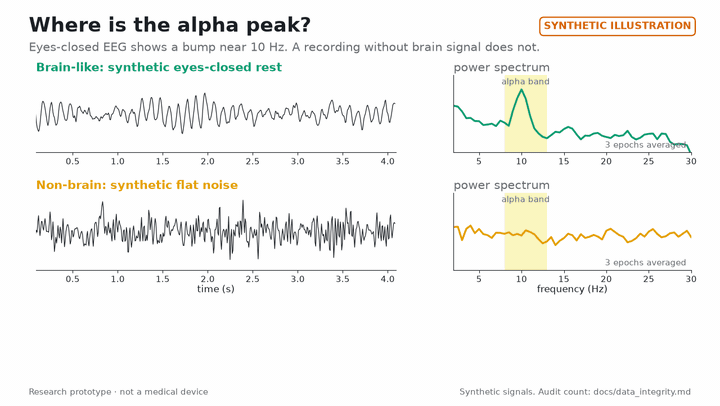
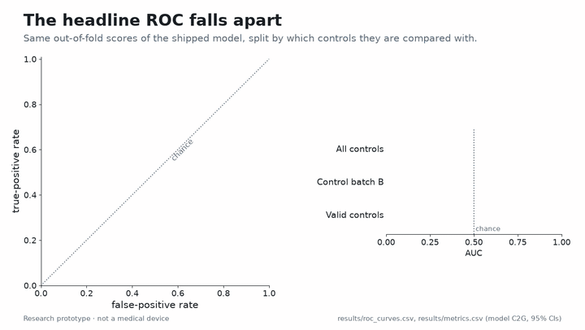
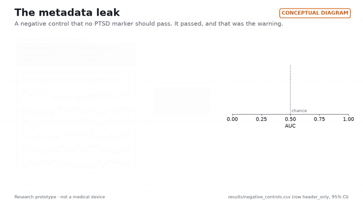
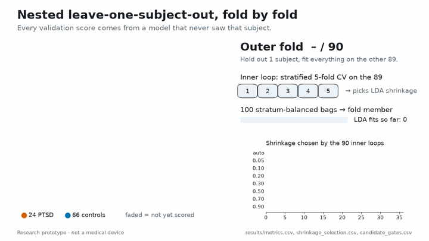

# The story: how my PTSD model turned out to be detecting broken recordings

*Bogdan (zititank)*

## TL;DR

Our resting-EEG "PTSD detector" scored AUC 0.816 and got us to the oral defense stage of an international medical
AI hackathon (name withheld under the data agreement). Then I audited it. None of the 46 recordings in one
control batch had an alpha peak, file metadata alone gave AUC 0.97, and against the valid controls the model was at
chance (0.435). This repository contains no PTSD biomarker. It contains the safety nets that caught the problem.

## What happened

I'm a biomedical engineering student and a software engineer, not an ML researcher. Even so, when our team had to
choose who would present the project, they picked me, the person with the least machine-learning experience.

The task looked clean. We had one minute of eyes-closed EEG per person from a six-electrode dry headset, about 90
people (24 of them with PTSD), and one question: can you tell the two groups apart? We built a small model on four
occipital alpha features, validated it with leave-one-subject-out cross-validation, and got AUC 0.816. That was
enough to reach the oral defense.

To prepare for the defense I had to explain what the model had actually learned, and that is where it fell apart.
Its biggest weight said "more alpha means more PTSD". The literature says the opposite, or no change. A model that
contradicts the biology isn't a discovery. It's a question you have to answer.

So I stopped asking "how good is the model?" and started asking "is this even brain?" A relaxed person with closed
eyes should show an alpha peak, the most basic sign of a real EEG recording. All 46 recordings in one control batch
failed: not one had an alpha peak. Then came the worst result: a classifier that saw only file metadata and no
signal at all separated the groups with AUC 0.97.

The model hadn't learned PTSD. It had learned which recordings were broken. Against the 20 controls with real
recordings, its AUC was 0.435, which is chance.

Oddly, this is when the project got interesting. I realised that what I had actually built wasn't a classifier. It
was a pipeline of safety nets. Every person stays on one side of every split, and every learned step is fitted
inside the training fold. Before we scored any new candidate, we wrote the decision rule down and hashed it, so
nobody could move the goalposts afterwards: not me, and not the AI. It felt like building a sandbox with the rules
fixed in advance and then letting the experiments run inside it.

AI agents in my editor wrote most of the code. That made building fast, and it made auditing non-negotiable: every
number is checked by script against the result tables, retraining reproduces within 5e-16, and the privacy scan has
to report zero hits. My job shifted from writing code to designing checks and deciding what to trust.

The biggest lesson is the least technical one: don't assume data is universal. A recording from one batch is not
the same object as a recording from another batch, even when the file format matches. That is why
leave-one-subject-out validation is the minimum, and why even that isn't enough when a whole batch is broken.

I sit between biology and engineering, and that turned out to be the useful position. The biology told me the
model was wrong, and the engineering let me prove it. I now think of this as a systems-engineering project with a
statistics module, not the other way round.

## Lessons, with the numbers behind them

1. **Ask "is it brain?" before "is it PTSD?"** None of the 46 rest recordings in control batch B has an alpha peak.
   Most of the separation came from that one batch.
    ·
   [video](../media/brain_vs_nonbrain.mp4) ·
   [synthetic figure](../figures/brain_vs_nonbrain.png)

2. **A headline AUC needs its twin.** The same model scores 0.816 [0.750, 0.875] against all controls,
   0.982 [0.937, 1.000] against control batch B alone, and 0.435 [0.256, 0.604] against valid controls. Always report
   the number against the controls you trust.
    · [ROC with CIs](../figures/roc_ci.png)

3. **Run a metadata-only control.** A classifier given file headers and no EEG reached AUC 0.97. If metadata can do
   your job, your model may be doing the same thing.
   

4. **Split by person and fit inside the fold.** We used nested leave-one-subject-out validation over 90 people with
   90 × 100 bagged shrinkage-LDA fits. A label-permutation run gives AUC 0.349, inside the null range
   [0.142, 0.580]. That rules out leakage, but it can't fix a broken batch.
    · [nested LOSO diagram](../figures/loso_diagram.png)

5. **Let the biology audit the model.** The main weight, `clr_alpha_O`, is +1.57 and positive in 98.7% of 9000
   fits, the opposite of the direction the literature predicts. That contradiction is how we found the data problem.
   [coefficient spread](../figures/coefficient_spread.png)

6. **Fix the rules before the results.** The pre-registered decision rule chose the shipped model because it
   flagged fewer somatoform and 65+ patients (21/97 → 13/97), not because it found PTSD better (sensitivity
   9/24 → 5/24). Writing the rule first is what makes that honest reading possible.
   [decision rule](../figures/decision_rule.png) · [v3 vs shipped model](../figures/v3_vs_c2g.png)

7. **AI builds, a human audits.** The code was mostly written by AI agents, so every safeguard is one that doesn't
   depend on trusting them. Retraining reproduces within 5e-16, the clean-environment difference is 0.0, and a
   script checks every number in the docs. Details: [ai_assistance.md](ai_assistance.md).

## What I'd do next

- **Integrity checks before labels.** Run the "is it brain?" checks on every recording before anyone looks at the
  diagnosis, and exclude or re-record batches that fail.
- **Validate across batches, not just people.** Add leave-one-batch-out and leave-one-site-out validation next to
  leave-one-subject-out.
- **A powered, eyes-closed replication.** Our external check (ρ −0.04 [−0.63, 0.59], n = 15, eyes open) was null
  and underpowered.
- **Ship the QC on its own.** Turn the integrity checks into a small standalone tool for dry-EEG recordings, since
  that part generalises and the classifier doesn't.

## Team

| Who | GitHub | Role |
|---|---|---|
| Bogdan (zititank) | [@zititank](https://github.com/zititank) | Pipeline, audits, pre-registration, presentation and oral defense, this repository |
| AdetyTy | [@AdetyTy](https://github.com/AdetyTy) | Hackathon teammate - ML and data |
| Qwertyqwerty579 | [@Qwertyqwerty579](https://github.com/Qwertyqwerty579) | Hackathon teammate - ML and data |

Thanks to the people who recorded the data and to the organisers, who are not named here because of the data
agreement. Mistakes in this repository are mine.
