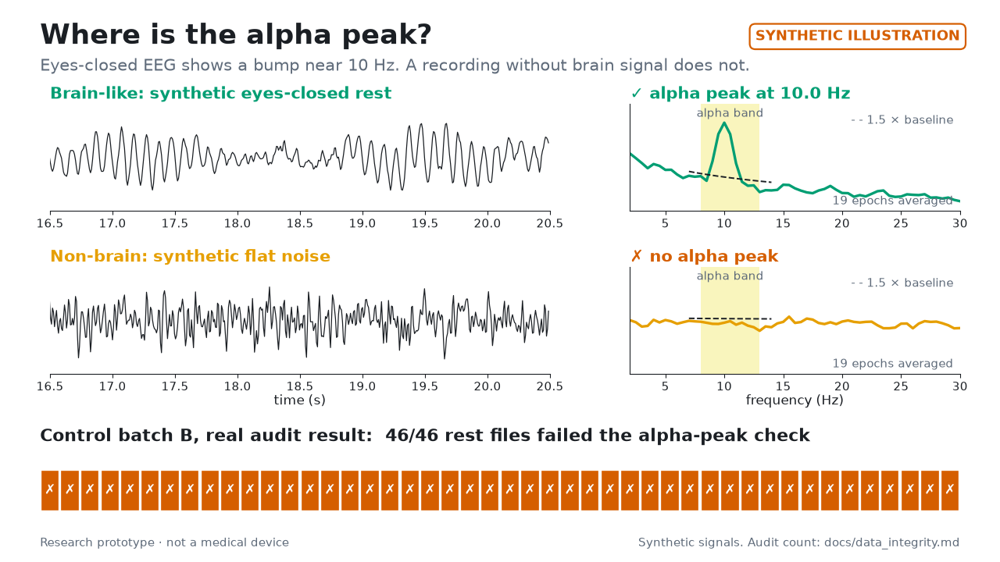
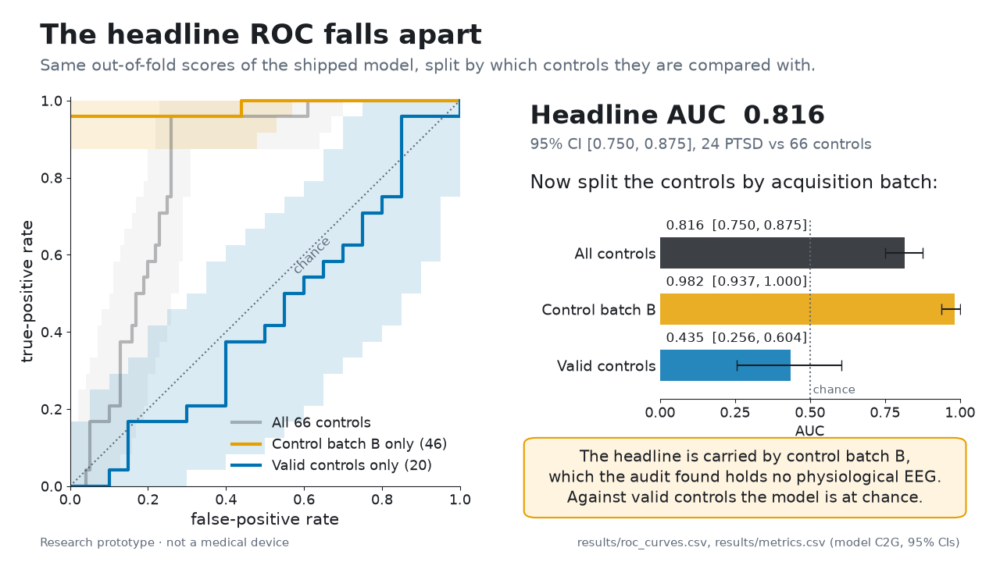
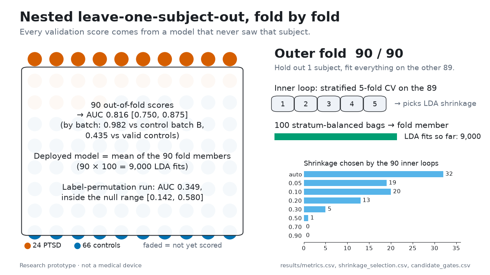
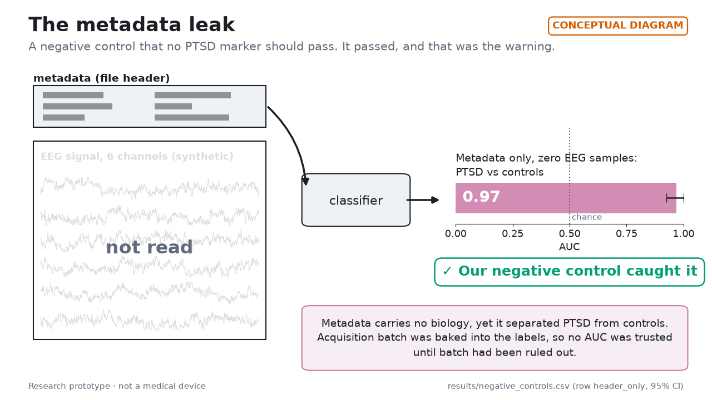
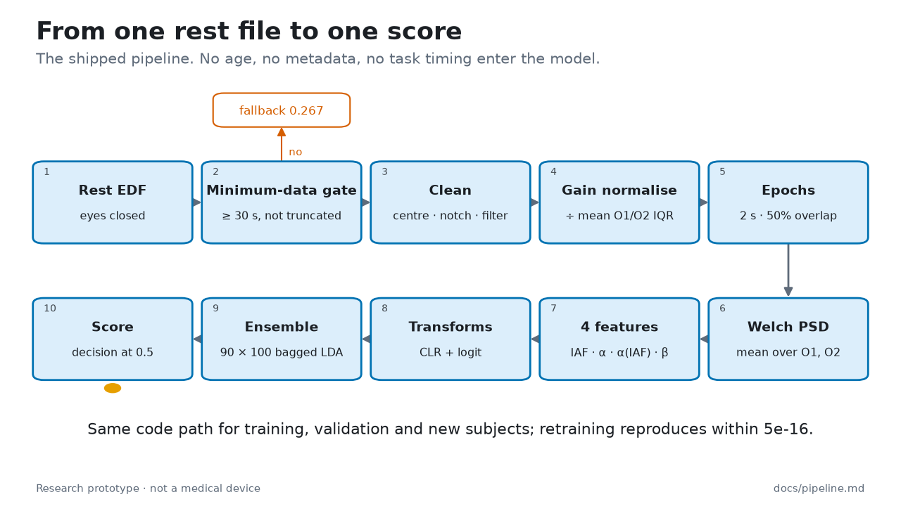

# Media

Animations and the banner for the README. Every asset is regenerated from the repository root by

```bash
make animations                                        # all five scenes + banner into media/
python tools/make_animations.py --only roc_falls_apart banner
```

Numbers come only from the aggregate tables in `results/`. Signals are synthetic (fixed seed). Each animation
ships as an MP4 (H.264, yuv420p, 1280×720, 24 fps), a GIF preview (at most 720 px wide, 10 fps) and a poster PNG
(the final frame). Frames are written to a temporary `.frames` folder under the output directory and deleted after encoding. The outputs carry no
metadata. Needs an ffmpeg with libx264 (`FFMPEG=/path/to/ffmpeg` overrides the lookup).

| Asset | Length | Data |
|---|---|---|
| [`brain_vs_nonbrain`](brain_vs_nonbrain.mp4) | 12.0 s | synthetic signals; audit count from [docs/data_integrity.md](../docs/data_integrity.md) |
| [`roc_falls_apart`](roc_falls_apart.mp4) | 13.0 s | `results/roc_curves.csv`, `results/metrics.csv` (C2G) |
| [`loso_folds`](loso_folds.mp4) | 14.0 s | `results/metrics.csv`, `results/shrinkage_selection.csv`, `results/candidate_gates.csv` |
| [`metadata_leak`](metadata_leak.mp4) | 12.0 s | `results/negative_controls.csv` (row `header_only`) |
| [`pipeline_flow`](pipeline_flow.mp4) | 10.5 s | [docs/pipeline.md](../docs/pipeline.md) |
| [`banner.png`](banner.png) | still | 1280×400 |

## Captions

**brain_vs_nonbrain.** *Synthetic illustration.* Eyes-closed EEG shows a spectral bump near 10 Hz (the alpha
peak); a recording without brain signal has a flat spectrum. The alpha-peak check needs a peak in 7–14 Hz at least
1.5 × a fitted baseline. In the real data, 46 of 46 rest files in control batch B failed that check.



**roc_falls_apart.** The shipped model's out-of-fold ROC reaches AUC 0.816 [0.750, 0.875] against all 66 controls.
Split the same scores by acquisition batch: 0.982 [0.937, 1.000] against control batch B (46), which the audit
found holds no physiological EEG, and 0.435 [0.256, 0.604] against the 20 valid controls, which is chance.



**loso_folds.** Nested leave-one-subject-out over 90 subjects (24 PTSD, 66 controls). Each outer fold holds out
one subject; an inner stratified 5-fold CV on the other 89 picks the LDA shrinkage; 100 bags give the fold
member that scores the held-out subject. The deployed model is the mean of the 90 members (9,000 LDA fits).
A label-permutation run gives AUC 0.349, inside the null range [0.142, 0.580].



**metadata_leak.** *Conceptual diagram.* A negative control no PTSD marker should pass. A classifier that reads
only file metadata, and no EEG sample, separates PTSD from controls with AUC 0.97 [0.92, 1.00]. Our negative
control caught it: metadata carries no biology, so no AUC was trusted until acquisition batch had been ruled out.



**pipeline_flow.** From one eyes-closed rest file to one score: minimum-data gate (fallback 0.267 = 24/90),
cleaning, gain normalisation, 2 s epochs, Welch PSD, four spectral features, CLR and logit transforms, and a
90 × 100 bagged shrinkage-LDA ensemble with a decision at 0.5. No age, metadata or task timing enter the model.



**banner.** "PTSD from EEG — a safety-net case study". Research prototype, not a medical device.

## Embedding

GitHub does not play relative-path `<video>` in READMEs, so the README embeds each GIF and links it to the MP4:

```markdown
[](media/roc_falls_apart.mp4)
```

For a lighter page, swap the `.gif` for `_poster.png` and keep the MP4 link.
